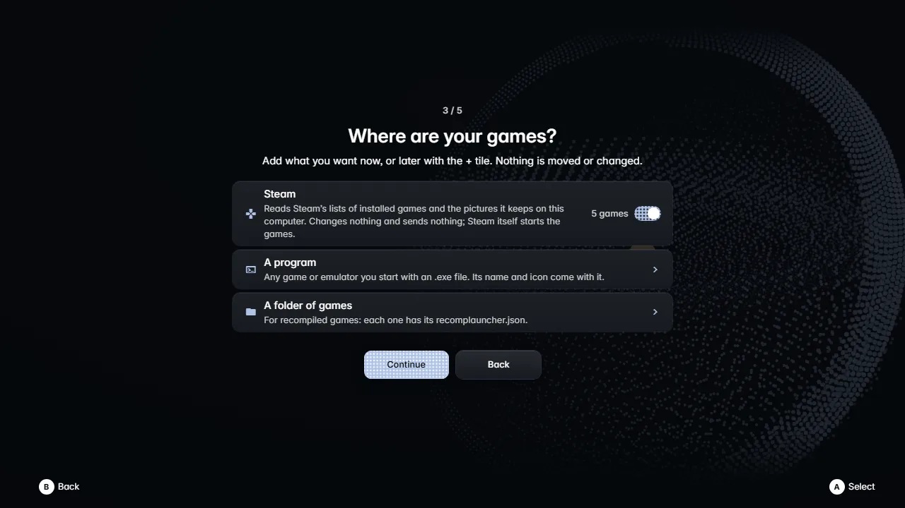
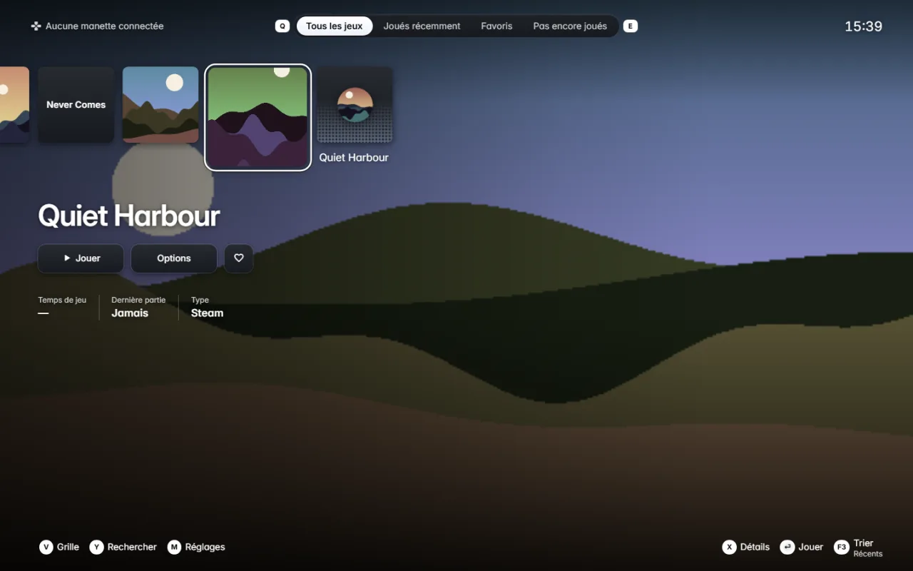
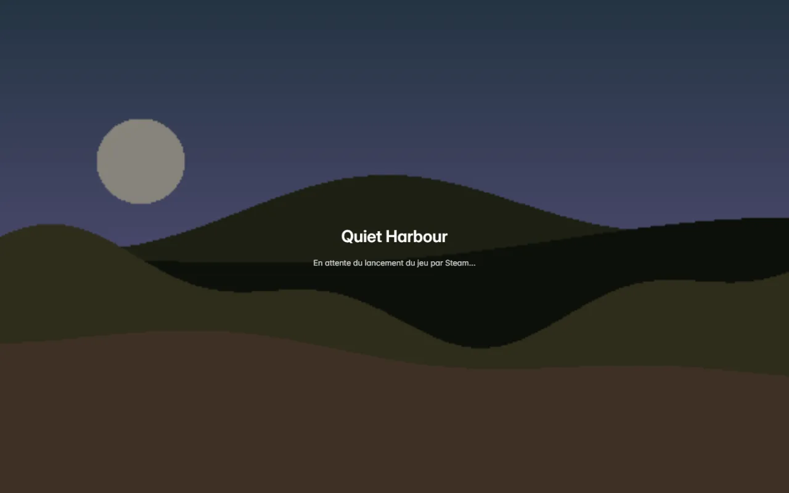
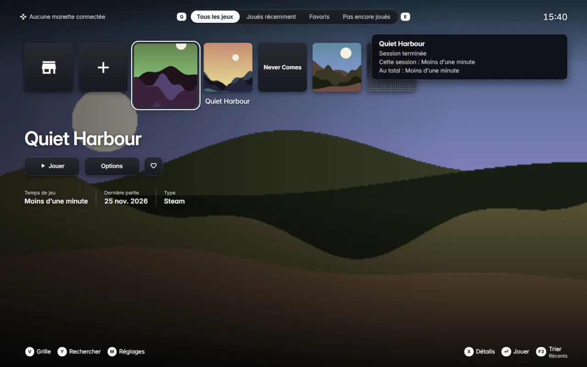

## Turn Steam on
<!-- step on checked f18e2119:desktop/tests/steam.js f18e2119:desktop/tests/windows/prove.ps1 f18e2119:Sources/OortCompanion/SteamShelf.swift -->
In the guided setup, the **+** tile or **Settings › Integrations › Steam**. Oort reads the installed games, on every drive, and writes nothing in Steam.

## Find them
<!-- step shelf checked f18e2119:desktop/tests/steam.js f18e2119:desktop/tests/windows/prove.ps1 -->
Their pictures are the ones Steam already keeps on your computer. Tools and soundtracks are left out; a game must be fully downloaded.

## Play
<!-- step play checked f18e2119:desktop/tests/steam.js f18e2119:desktop/tests/windows/prove.ps1 f18e2119:desktop/src-tauri/src/steam.rs -->
**Play** asks Steam for the game, and Steam starts it. If it updates it first, Oort waits; **Cancel** stops waiting.

## Come back
<!-- step back checked f18e2119:desktop/tests/steam.js f18e2119:desktop/tests/windows/prove.ps1 -->
Quit the game: Oort comes back and counts the time. Checked with an invented Steam, never with the real one.

