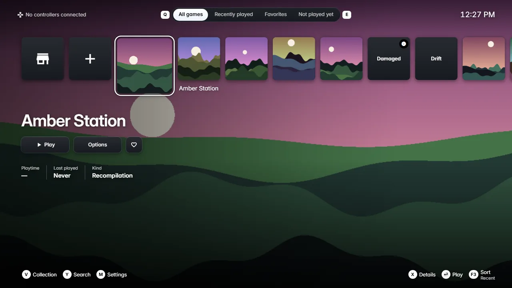
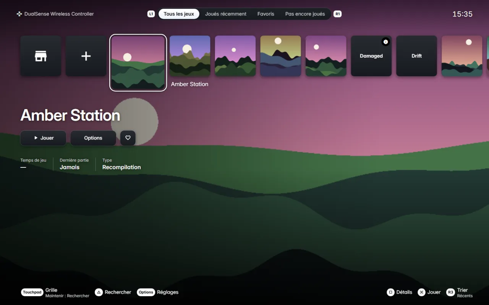
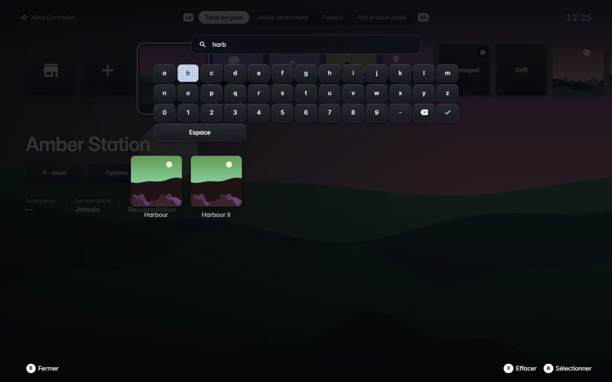
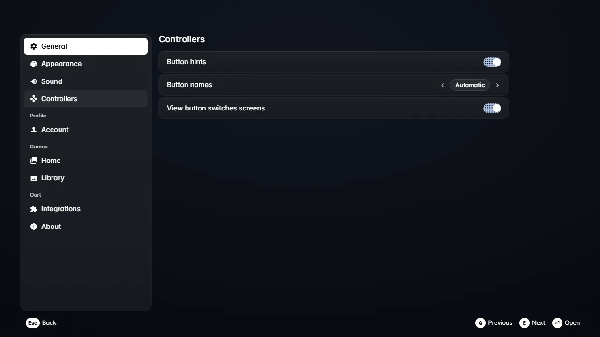

## The useful buttons
<!-- step keys checked f18e2119:desktop/ui/app.js f18e2119:desktop/tests/pad.js -->
Reminders are at the bottom of the screen.

| Action | Xbox | Keyboard |
|---|---|---|
| Play, select | A | Enter |
| Back | B | Esc |
| Details | X | X |
| Search | Y | Y or Ctrl F |
| Grid or spotlight | View | V |
| Change tab | LB / RB | Q / E |
| Sort | Right stick | F3 |
| Settings | Menu | M |
| Full screen | | F11 |

## Your controller
<!-- step prompts checked f18e2119:desktop/ui/nav.js f18e2119:desktop/tests/pad.js -->
Its name shows at the top left and the reminders take its buttons: Xbox, PlayStation or Nintendo. Checked with simulated controllers, not with a real one yet.

## Type with a controller
<!-- step type checked f18e2119:desktop/ui/app.js f18e2119:desktop/tests/pad.js -->
Search opens an on-screen keyboard. **X** erases.

## Change the button names
<!-- step change checked f18e2119:Sources/OortCompanion/SettingRows.swift -->
**Settings › Controllers › Button names**. A game’s own keys are changed in the game.

