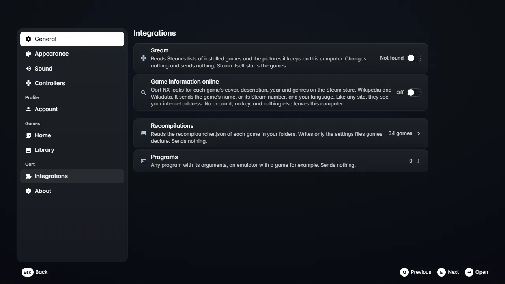

## Reads
<!-- step reads code cc9db84a:desktop/README.md cc9db84a:Sources/OortCompanion/Companion.swift -->
The folders and programs you add, and each game’s `recomplauncher.json`. Of a copy you choose, it looks at the name and place.

## Writes
<!-- step writes code cc9db84a:Sources/OortCompanion/Store.swift cc9db84a:Sources/OortCompanion/Places.swift -->
Its folder `%LOCALAPPDATA%\io.github.sofianbll.oort-nx.desktop` and the settings files a recompiled game declares. A game’s last messages are kept in its logs.

## Sends
<!-- step sends code cc9db84a:desktop/README.md cc9db84a:desktop/src-tauri/tauri.conf.json -->
Nothing: no account, no measurement, no data. Project links open in your browser, and the installer may ask Microsoft for WebView2.

