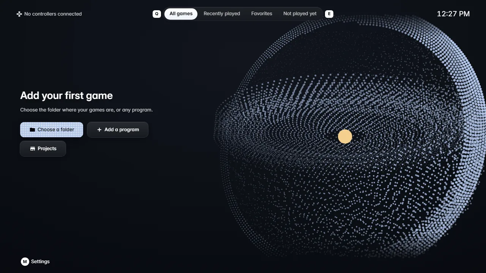
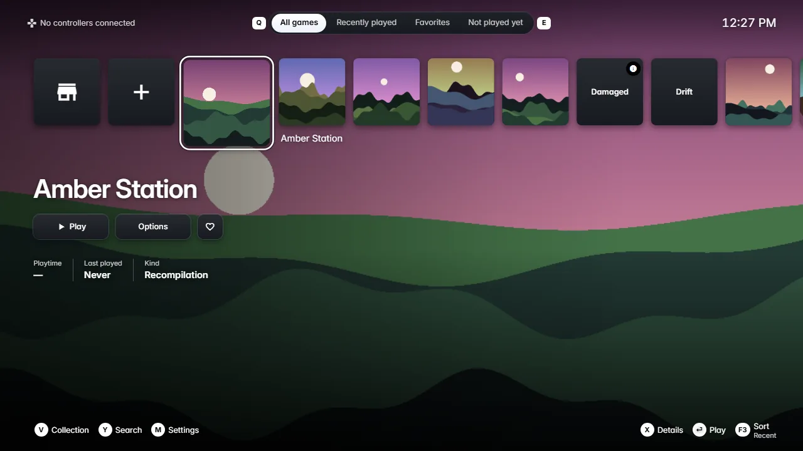
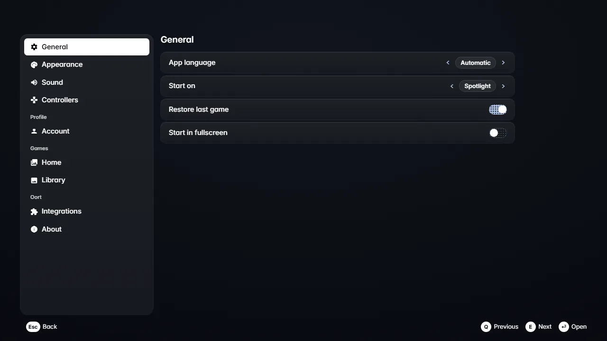

## Choose where to start
<!-- step empty checked cc9db84a:desktop/ui/app.js cc9db84a:desktop/tests/first.js -->
**Choose a folder** for recompiled games, **Add a program** for a game or an emulator you already have. Nothing is downloaded.

## Find your games
<!-- step home checked cc9db84a:desktop/ui/app.js cc9db84a:desktop/tests/walk.js -->
Each game is a tile. The first two tiles open **Projects** and **Add game**.

## Check the language
<!-- step language checked cc9db84a:Sources/OortCompanion/SettingRows.swift -->
**Settings › General › App language**: automatic, French or English.

