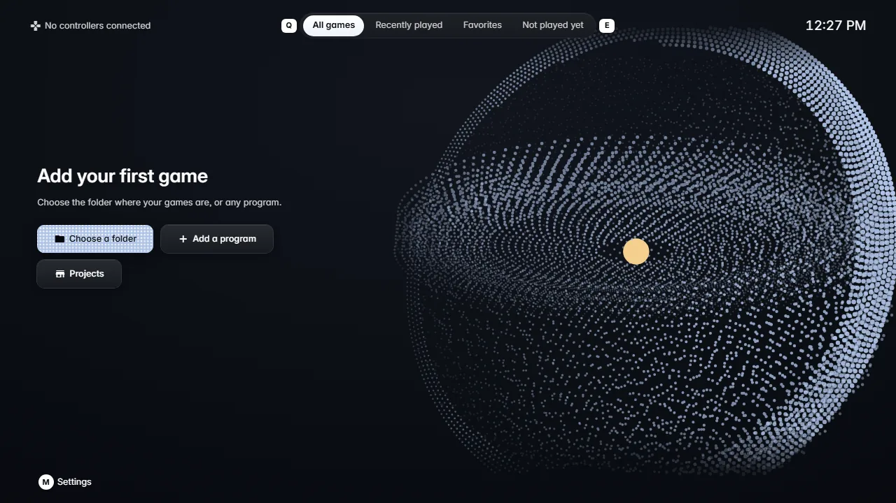

## Download
<!-- step download code cc9db84a:desktop/src-tauri/tauri.conf.json https://github.com/sofianbll/oort-nx/releases/tag/windows-v0.1.0-alpha.1 -->
Take `Oort-NX-Windows-0.1.0-alpha.1-x64-setup.exe` and `SHA256SUMS` from the [release page](https://github.com/sofianbll/oort-nx/releases/tag/windows-v0.1.0-alpha.1). You need 64-bit Windows 10 or 11; Windows 10 was not tried.

<!-- missing release-page: The release page on GitHub, files unfolded. -->

## Compare the checksum
<!-- step checksum code cc9db84a:desktop/tests/windows/prove.ps1 https://github.com/sofianbll/oort-nx/releases/tag/windows-v0.1.0-alpha.1 -->
In PowerShell, `Get-FileHash Oort-NX-Windows-0.1.0-alpha.1-x64-setup.exe` must give the line of `SHA256SUMS`. If it differs, delete the file.

<!-- missing checksum: The terminal with the checksum and its answer. -->

## Go past the warning
<!-- step warning code cc9db84a:desktop/tests/windows/prove.ps1 https://github.com/sofianbll/oort-nx/releases/tag/windows-v0.1.0-alpha.1 -->
The installer is not signed: Windows shows “Windows protected your PC”. Choose **More info**, then **Run anyway**, only for this checked file.

<!-- missing smartscreen: The SmartScreen window, before and after “More info”. -->

## Follow the installation
<!-- step run checked cc9db84a:desktop/tests/windows/prove.ps1 -->
It installs for your account, without administrator rights. If WebView2 is missing, the installer takes Microsoft’s; that case was not tried.

<!-- missing installer: The installer windows, one by one. -->

## Open Oort NX
<!-- step open checked cc9db84a:desktop/tests/windows/prove.ps1 -->
It is in the Start menu. The first page asks where your games are.

