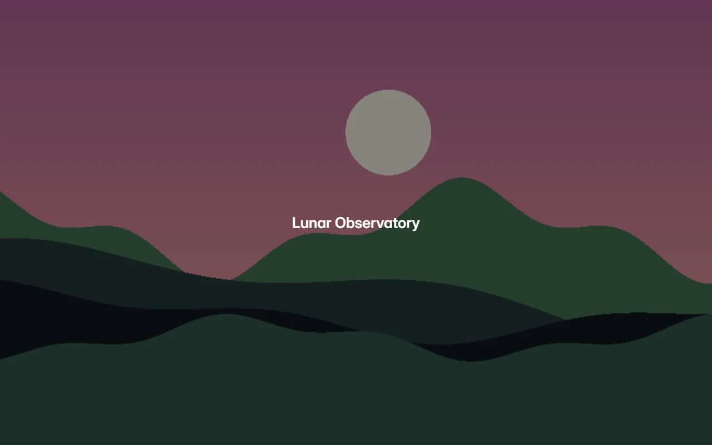
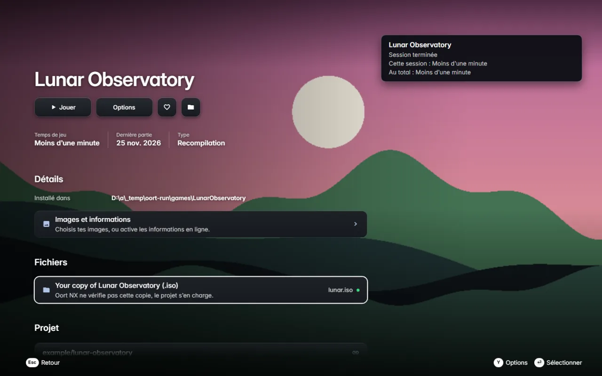
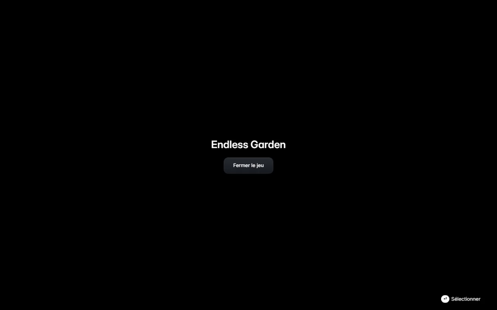

## Start
<!-- step play played cc9db84a:desktop/src-tauri/src/lib.rs cc9db84a:desktop/tests/windows/prove.ps1 -->
Choose **Play**. The screen shows the game, then Oort steps aside.

## Come back
<!-- step back checked cc9db84a:desktop/src-tauri/src/lib.rs cc9db84a:desktop/tests/windows/prove.ps1 -->
Quit the game as usual: Oort comes back in front and shows how long you played.

## Close a stuck game
<!-- step close checked cc9db84a:desktop/ui/app.js cc9db84a:desktop/tests/play.js -->
Go back to the Oort window: **Close Game** appears after four seconds. What is not saved is lost. The Home button is not supported in a game yet.

