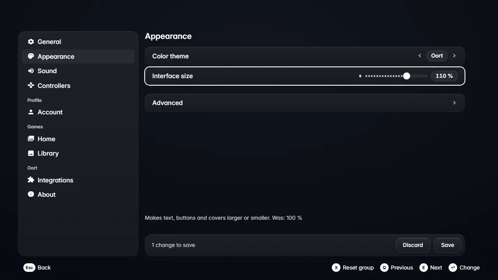
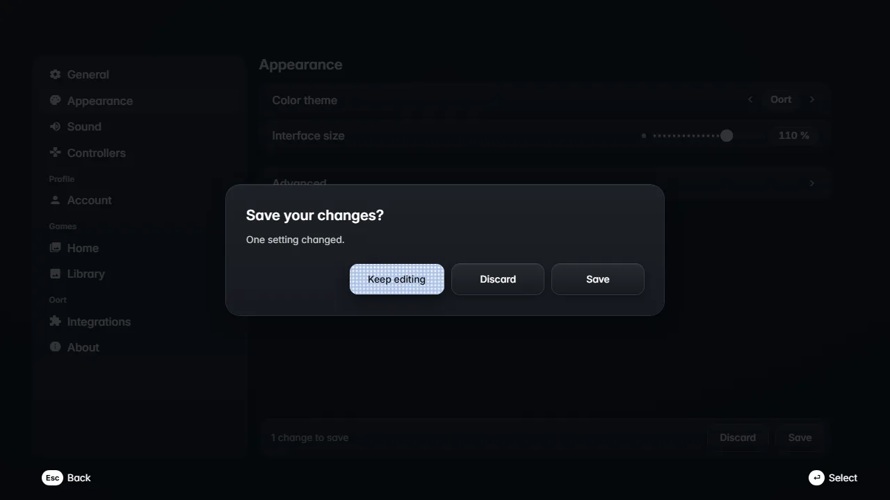
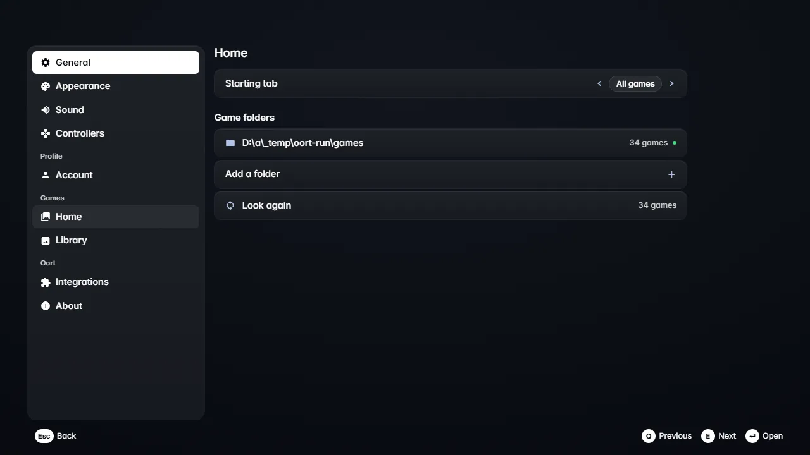
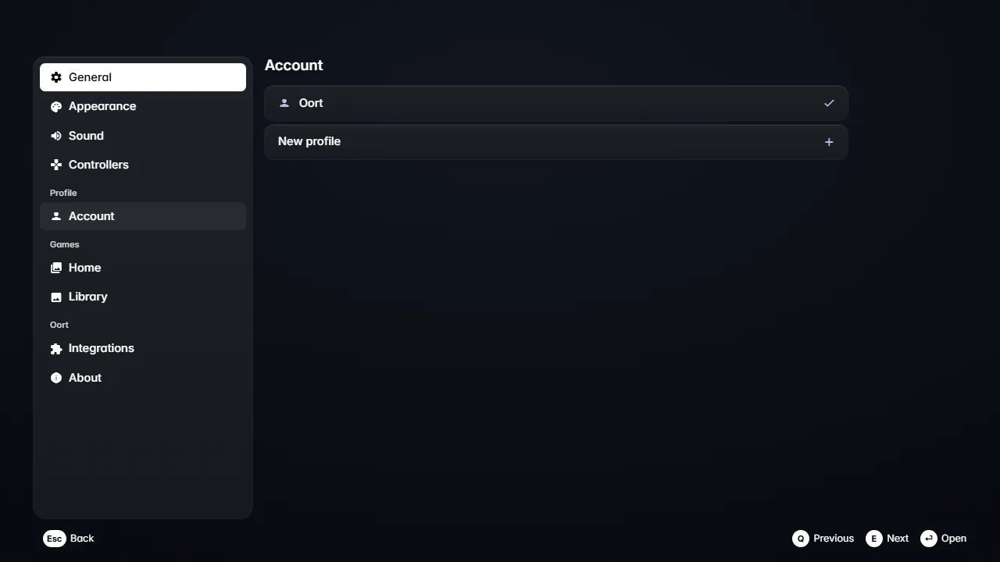
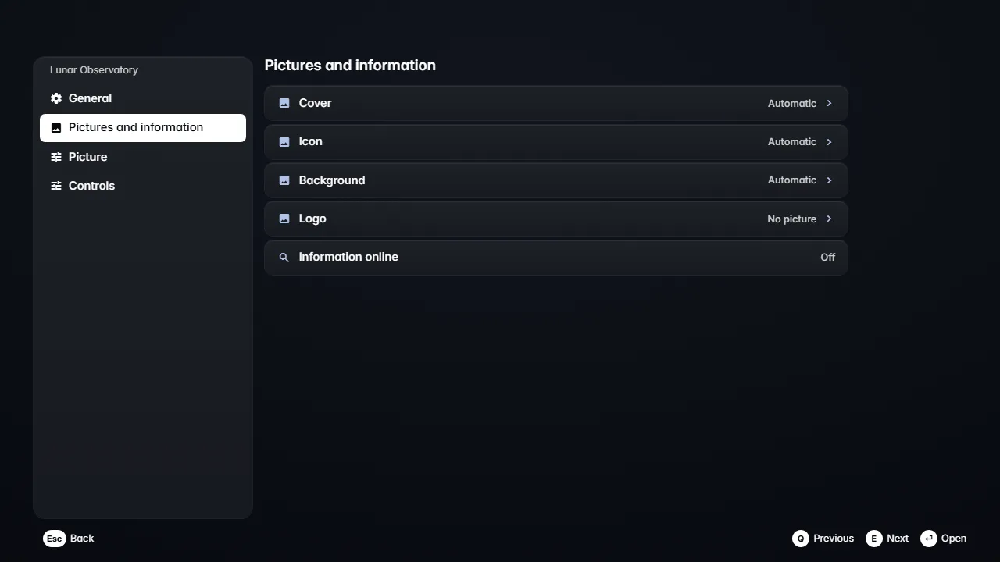

## Colours and size
<!-- step look checked f18e2119:Sources/OortCompanion/SettingRows.swift f18e2119:desktop/tests/look.js -->
**Settings › Appearance**: the theme and the interface size, from 80 to 125%.

## Save
<!-- step save checked f18e2119:desktop/ui/app.js f18e2119:desktop/tests/walk.js -->
A dot marks what you changed. **Save** keeps it, **Discard** undoes it.

## Game folders
<!-- step folders checked f18e2119:desktop/ui/app.js f18e2119:Sources/OortCompanion/Companion.swift -->
**Settings › Home** adds or removes a folder and reads it again. Removing a folder deletes nothing from the disk.

## Profiles
<!-- step profiles checked f18e2119:Sources/OortCompanion/Companion.swift -->
**Settings › Account** makes a profile per person, on this computer only.

## A game’s settings
<!-- step game checked f18e2119:desktop/ui/app.js f18e2119:Sources/OortCompanion/SettingRows.swift -->
For a recompilation, **Options** shows the settings the game declares. A program or a Steam game only has its pictures and information.

