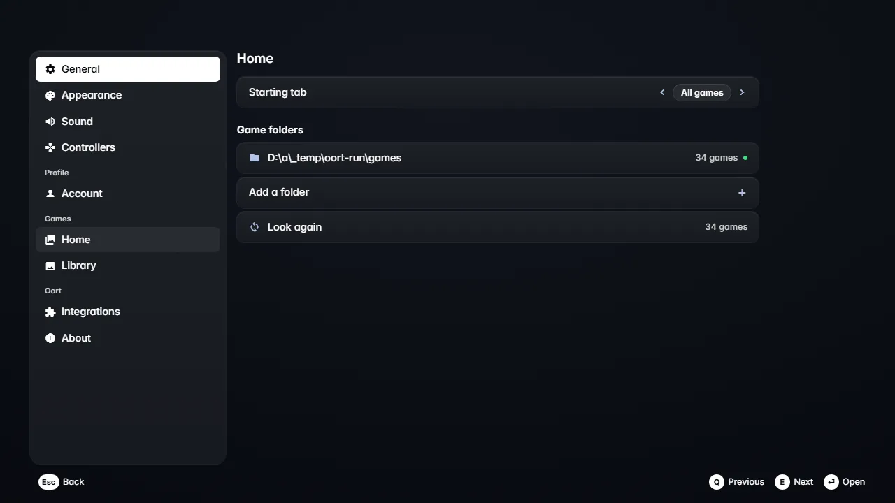
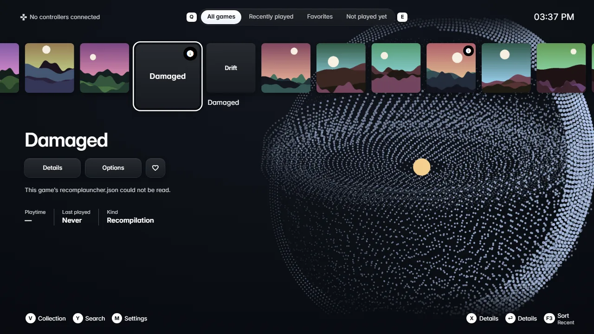
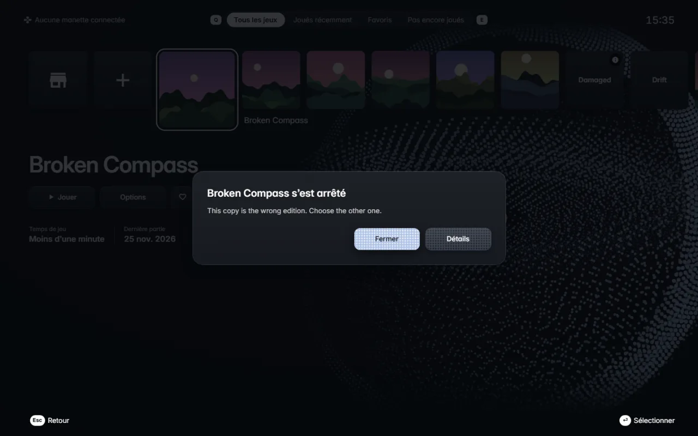
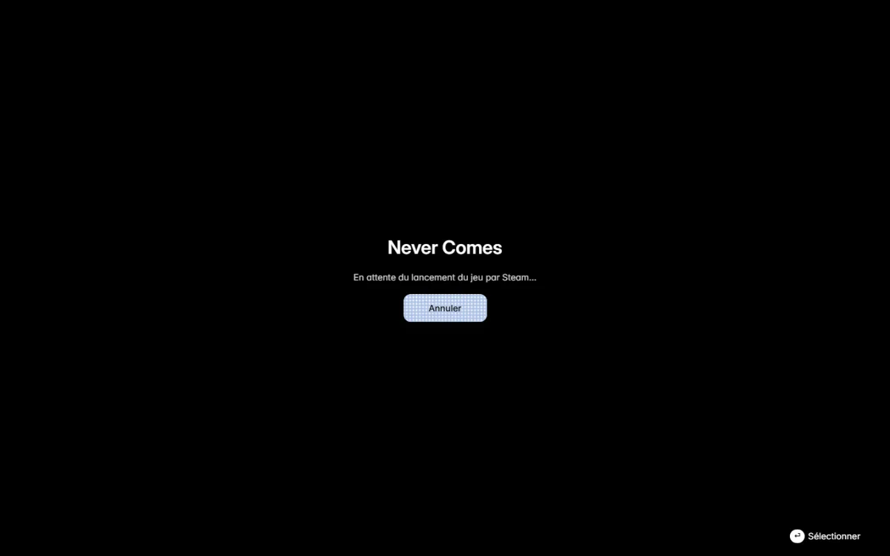
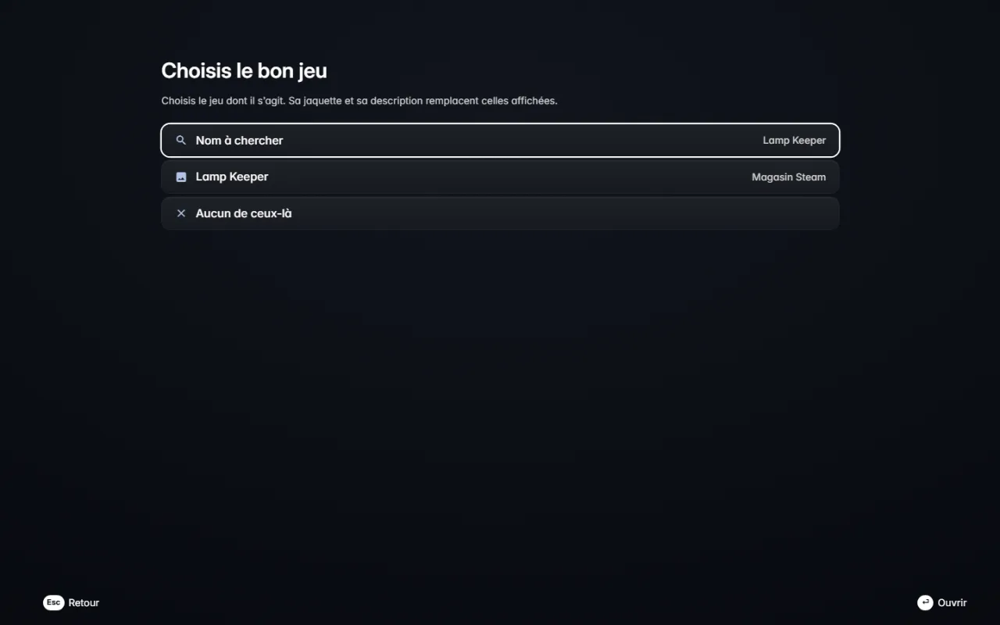
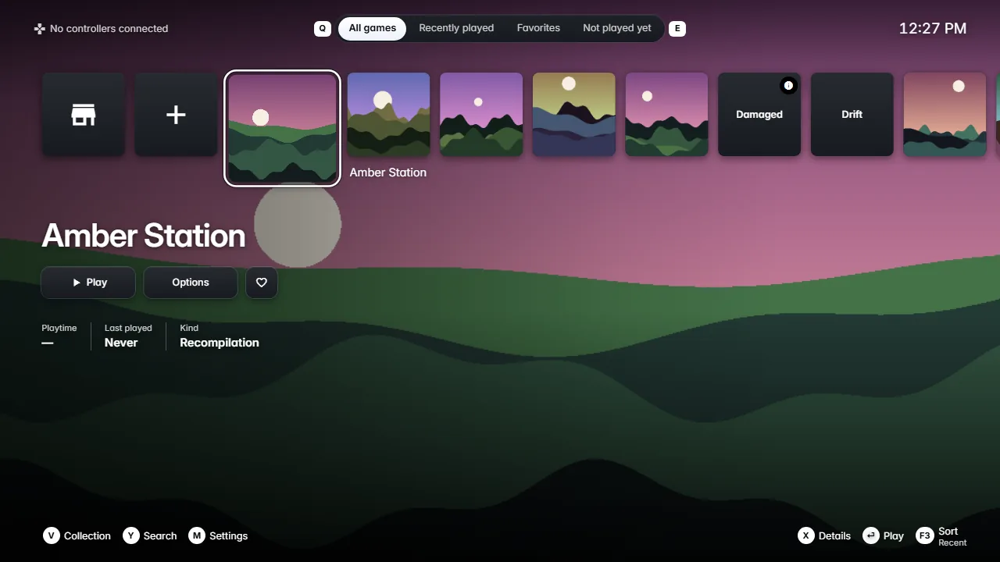

## A game is missing
<!-- step missing checked f18e2119:desktop/ui/app.js f18e2119:Sources/OortCompanion/Companion.swift -->
**Settings › Home › Look again**. For a recompilation, check that its folder holds `recomplauncher.json`.

## The game is marked unreadable
<!-- step unreadable checked f18e2119:desktop/ui/app.js f18e2119:desktop/tests/walk.js -->
Its `recomplauncher.json` is damaged or asks for a newer launcher. Take it again from the project.

## The game stops
<!-- step crash checked f18e2119:desktop/src-tauri/src/lib.rs f18e2119:desktop/tests/play.js -->
Oort shows the message the game left. Then check that the game starts on its own, outside Oort.

## Steam does not answer
<!-- step steam checked f18e2119:desktop/tests/steam.js f18e2119:Sources/OortCompanion/SteamShelf.swift -->
“Not found”: open Steam once, then **Settings › Home › Look again**. If it keeps waiting, look at Steam’s window: it is probably asking something.

## Wrong cover, or none
<!-- step cover checked f18e2119:desktop/tests/online.js f18e2119:Sources/OortCompanion/Online.swift -->
**Options › Pictures and information**: choose the right game, change the name, or take a picture of yours. Without information online, a program only has its icon.

## The controller is not seen
<!-- step pad code f18e2119:desktop/src-tauri/src/pad.rs f18e2119:desktop/ui/nav.js -->
Press a button with the Oort window in front, then unplug it and plug it in again. Not tried with a real controller.

## Tell us
<!-- step report code f18e2119:SECURITY.md f18e2119:CONTRIBUTING.md -->
[Open a report](https://github.com/sofianbll/oort-nx/issues): what you were doing, what you saw, your version. Attach no game, key or save.

