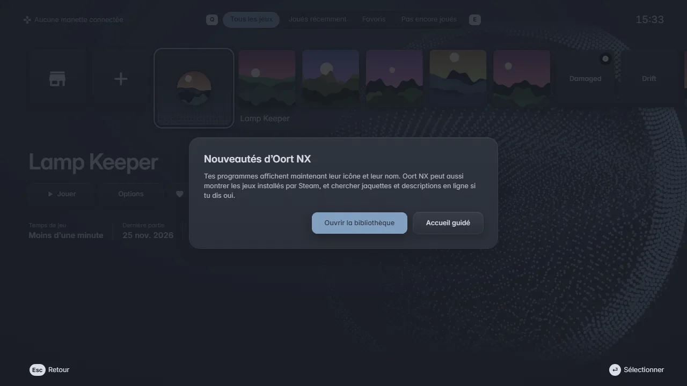

## See your version
<!-- step check code f18e2119:desktop/README.md https://github.com/sofianbll/oort-nx/releases/tag/windows-v0.1.0-alpha.2 -->
It is in **Settings › About**. Oort does not look for updates by itself on this system.

## Install over it
<!-- step over checked f18e2119:desktop/tests/windows/prove.ps1 f18e2119:desktop/tests/update.js -->
Run the new installer without uninstalling. From alpha.1 to alpha.2, the library, play time and settings stay; nothing new turns on by itself.

