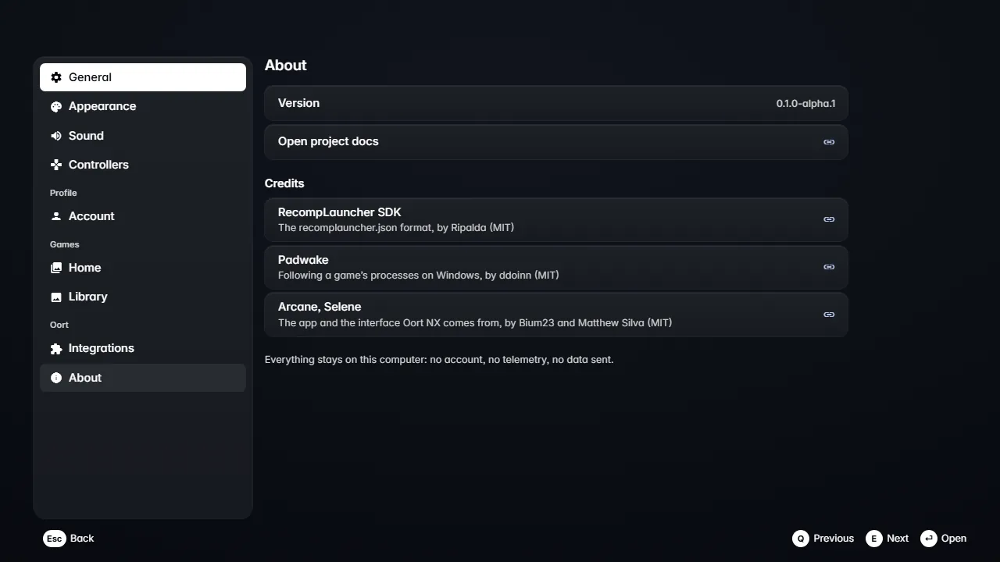

## See your version
<!-- step check code cc9db84a:desktop/README.md https://github.com/sofianbll/oort-nx/releases/tag/windows-v0.1.0-alpha.1 -->
It is in **Settings › About**. Oort does not look for updates by itself on this system.

## Install over it
<!-- step over checked cc9db84a:desktop/tests/windows/prove.ps1 -->
Run the new installer without uninstalling. Installing the same version again keeps your library; moving to another version was not tried.

