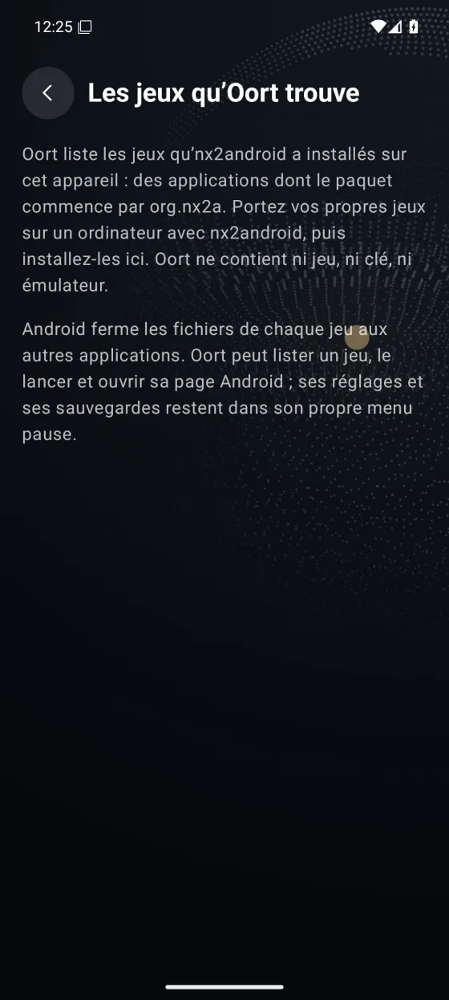
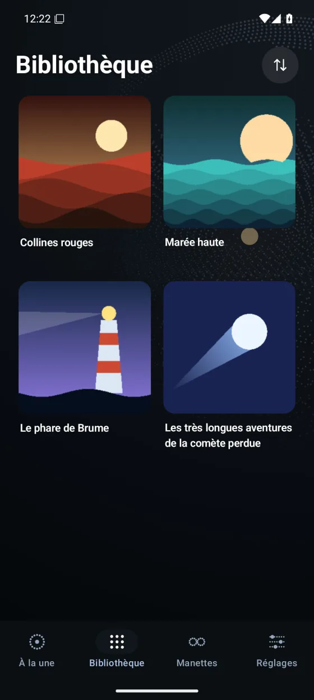

## Fabrique l’app du jeu
<!-- step port elsewhere https://github.com/shirai91/nx2android -->
Sur un ordinateur, [nx2android](https://github.com/shirai91/nx2android) transforme ton propre jeu en app Android. Oort n’y participe pas, et nous n’avons pas essayé un vrai jeu.

## Installe l’app du jeu
<!-- step install code 1aaff5c0:android/app/src/main/kotlin/io/github/sofianbll/oortnx/core/GameScanner.kt 1aaff5c0:android/tools/emulator_check.py -->
Comme n’importe quel APK. Oort garde les apps dont le paquet commence par `org.nx2a.`.

<!-- missing game-apk: Android pendant l’installation d’un jeu inventé. -->

## Reviens dans Oort
<!-- step found checked 1aaff5c0:android/tools/emulator_check.py -->
Le jeu apparaît tout seul, avec son icône. Sinon : **Réglages › Chercher à nouveau**.

