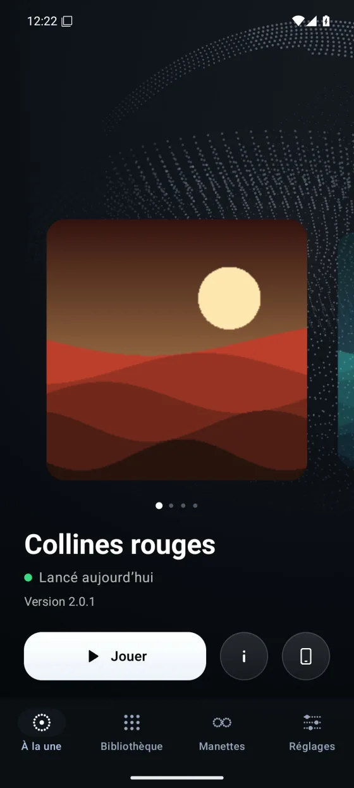
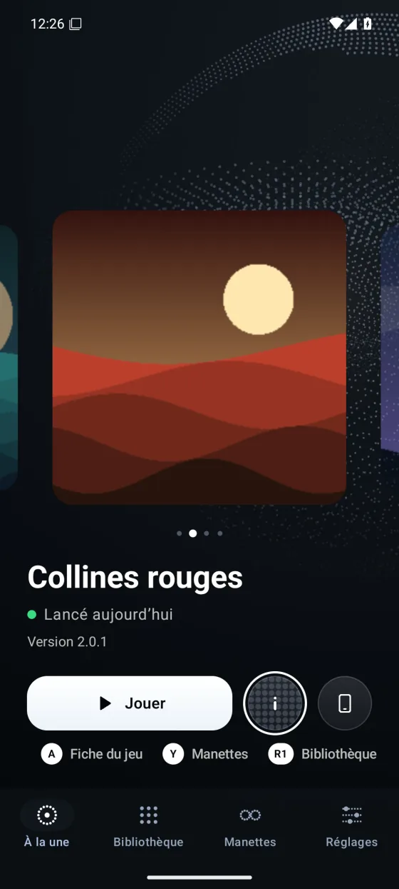
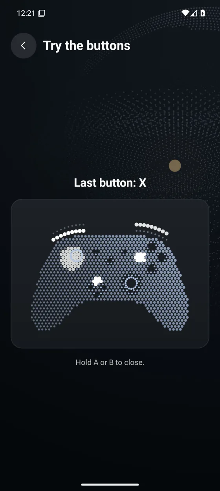
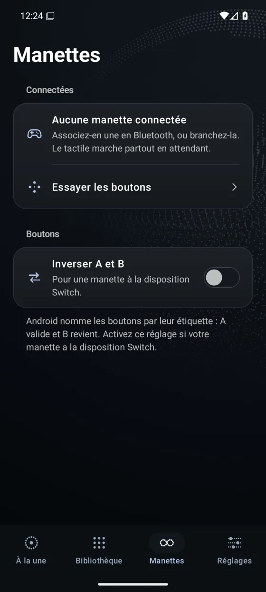

## Au doigt
<!-- step touch checked 1aaff5c0:android/tools/emulator_check.py -->
Tout marche au doigt. Toutes les cibles font au moins 48 dp.

## À la manette
<!-- step pad checked 1aaff5c0:android/tools/emulator_check.py 1aaff5c0:android/app/src/main/kotlin/io/github/sofianbll/oortnx/core/PadKeys.kt -->
Croix ou sticks pour bouger. A valide, B revient, X trie ou ouvre la fiche, Y ouvre les manettes. Start ouvre les réglages, L1 et R1 changent d’onglet.

## Essaie tes boutons
<!-- step test checked 1aaff5c0:android/tools/emulator_check.py 1aaff5c0:android/app/src/main/kotlin/io/github/sofianbll/oortnx/core/PadMonitor.kt -->
**Manettes › Essayer les boutons** : chaque bouton s’allume. Maintiens A ou B pour fermer. Vérifié avec une manette simulée, pas une vraie.

## Inverse A et B
<!-- step swap checked 1aaff5c0:android/tools/emulator_check.py 1aaff5c0:android/app/src/main/kotlin/io/github/sofianbll/oortnx/core/Prefs.kt -->
Pour une manette à la disposition Switch : **Manettes › Inverser A et B**.

