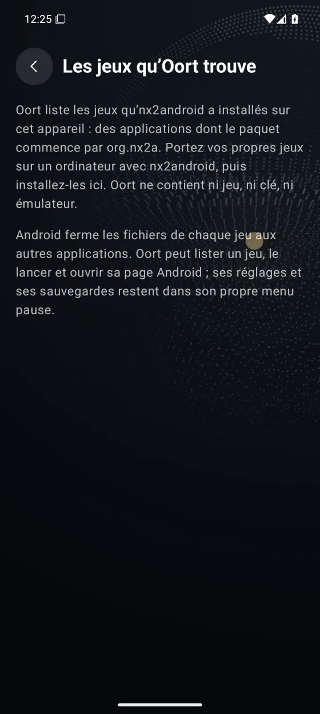
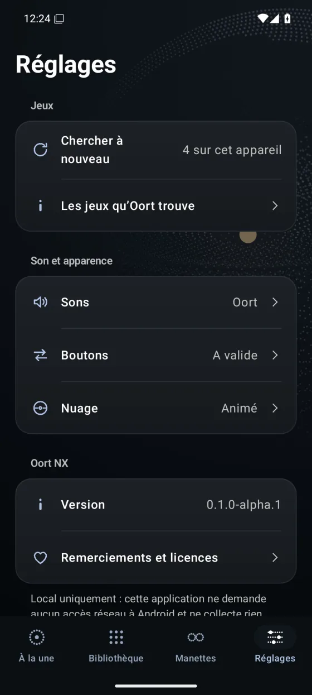

## Lit
<!-- step reads code 1aaff5c0:android/app/src/main/kotlin/io/github/sofianbll/oortnx/core/GameScanner.kt 1aaff5c0:android/app/src/main/AndroidManifest.xml -->
La liste des apps qu’Android montre dans son propre lanceur. Oort ne garde que celles des jeux nx2android.

## Écrit
<!-- step writes code 1aaff5c0:android/app/src/main/kotlin/io/github/sofianbll/oortnx/core/Prefs.kt -->
Ses réglages et le jour du dernier lancement de chaque jeu, dans l’app. Rien dans tes jeux.

## Envoie
<!-- step sends checked 1aaff5c0:android/app/src/main/AndroidManifest.xml 1aaff5c0:android/tools/emulator_check.py -->
Rien. L’app ne demande aucune autorisation à Android, pas même le réseau.

