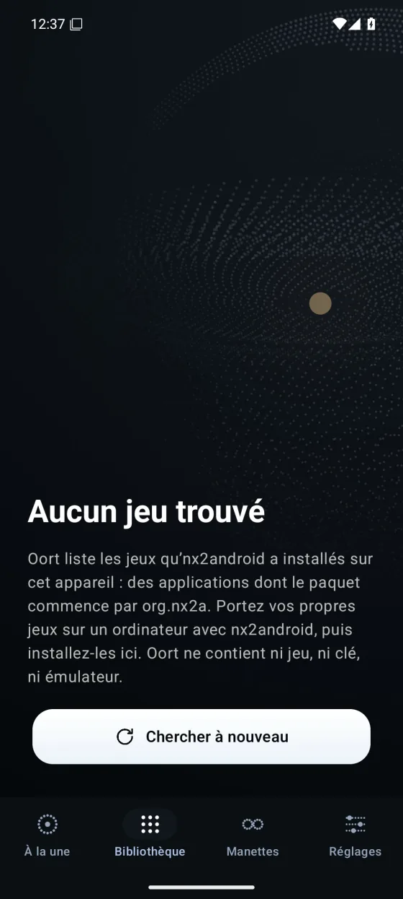
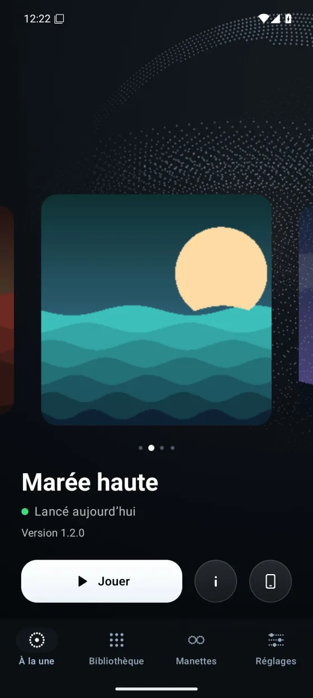
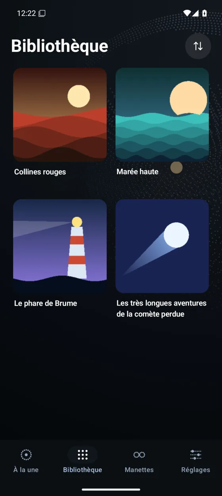

## Aucun jeu ? C’est normal
<!-- step empty checked 1aaff5c0:android/tools/emulator_check.py 1aaff5c0:android/app/src/main/res/values/strings.xml -->
Oort ne contient ni jeu, ni clé, ni moteur. Installe un jeu nx2android, puis **Chercher à nouveau**.

## À la une
<!-- step home checked 1aaff5c0:android/tools/emulator_check.py -->
Glisse la grande image pour changer de jeu. **Jouer** est sous le pouce.

## Quatre onglets
<!-- step tabs checked 1aaff5c0:android/tools/emulator_check.py -->
À la une, Bibliothèque, Manettes et Réglages. Dans la bibliothèque, le bouton en haut trie.

