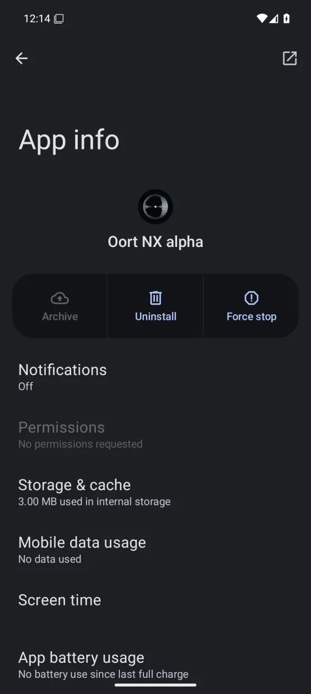

## Télécharge l’APK
<!-- step download code 1aaff5c0:android/app/build.gradle.kts https://github.com/sofianbll/oort-nx/releases/tag/android-v0.1.0-alpha.1 -->
Prends `Oort-NX-Android-0.1.0-alpha.1.apk` sur la [page de la version](https://github.com/sofianbll/oort-nx/releases/tag/android-v0.1.0-alpha.1), depuis ton appareil. Il faut Android 10 ou plus récent.

<!-- missing release-page: La page de la version dans le navigateur du téléphone. -->

## Autorise ton navigateur
<!-- step allow code 1aaff5c0:android/README.md https://github.com/sofianbll/oort-nx/releases/tag/android-v0.1.0-alpha.1 -->
Android demande si cette source peut installer des apps. Accepte pour ce fichier, puis retire l’autorisation si tu veux.

<!-- missing unknown-source: La demande d’Android pour une source inconnue, puis Play Protect s’il prévient. -->

## À savoir : clé provisoire
<!-- step key code 1aaff5c0:android/README.md https://github.com/sofianbll/oort-nx/releases/tag/android-v0.1.0-alpha.1 -->
Cette alpha a son propre identifiant et une clé provisoire. Une version finale s’installera à côté, et il faudra désinstaller l’alpha.

## Ouvre Oort NX alpha
<!-- step open checked 1aaff5c0:android/tools/emulator_check.py -->
L’app trouve seule les jeux nx2android déjà installés.

