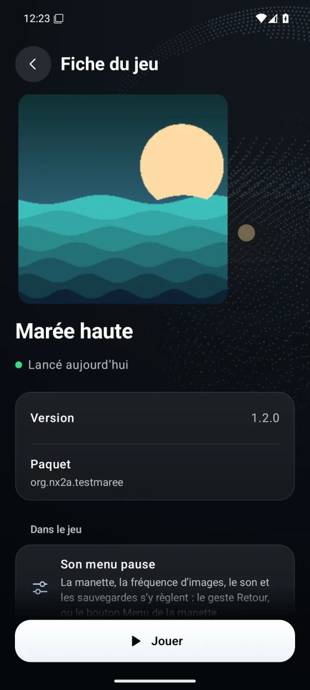
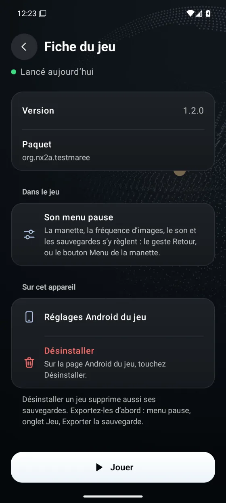

## Lance
<!-- step play checked 1aaff5c0:android/tools/emulator_check.py 1aaff5c0:android/app/src/main/kotlin/io/github/sofianbll/oortnx/core/GameLauncher.kt -->
Touche **Jouer**. Android ouvre l’app du jeu.

## Pendant la partie
<!-- step in-game code 1aaff5c0:android/app/src/main/res/values/strings.xml 1aaff5c0:android/README.md -->
Le geste Retour, ou le bouton Menu de la manette, ouvre le menu pause du jeu. C’est là que se trouvent ses réglages et ses sauvegardes.

## Reviens
<!-- step back checked 1aaff5c0:android/tools/emulator_check.py 1aaff5c0:android/app/src/main/kotlin/io/github/sofianbll/oortnx/core/LastStart.kt -->
Quitte le jeu ou repasse par les apps récentes. Oort note le jour du lancement, pas le temps de jeu.

