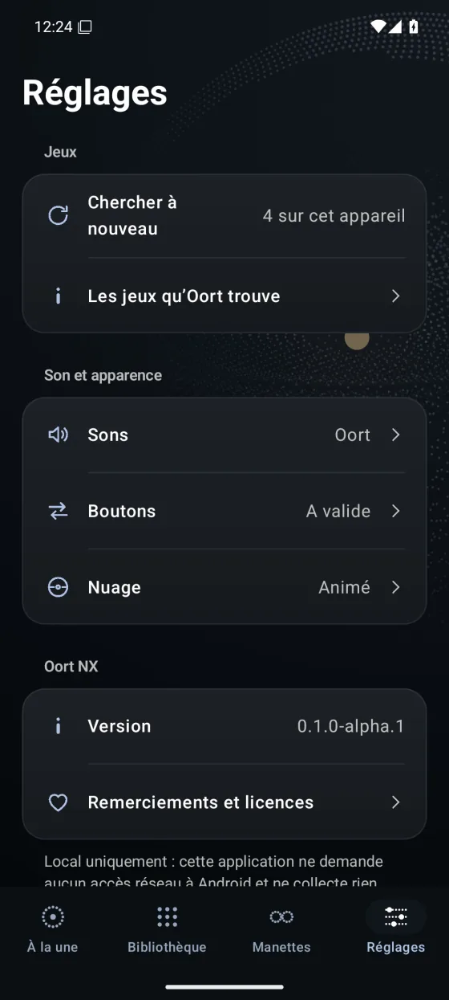
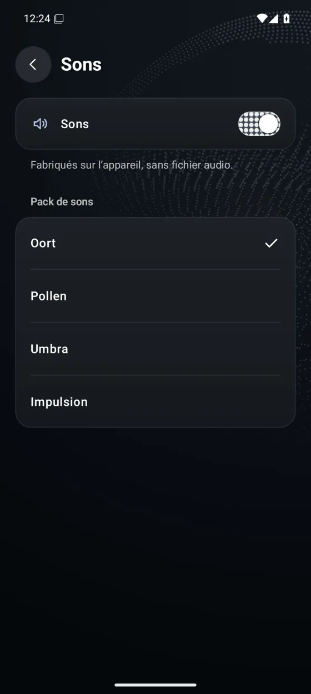
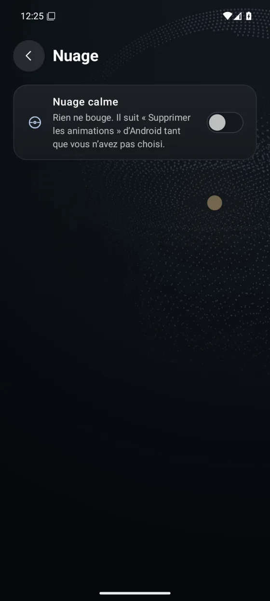
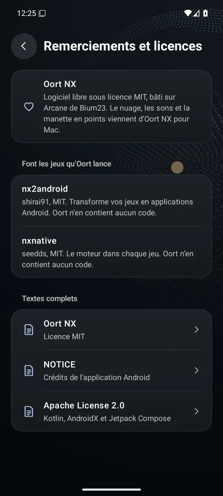

## Tout est sur une page
<!-- step all checked 1aaff5c0:android/tools/emulator_check.py 1aaff5c0:android/app/src/main/kotlin/io/github/sofianbll/oortnx/core/Prefs.kt -->
Jeux, sons, boutons, nuage et version.

## Les sons
<!-- step sounds checked 1aaff5c0:android/tools/emulator_check.py -->
Coupe-les, ou choisis Oort, Pollen, Umbra ou Impulsion. Personne ne les a encore écoutés sur un vrai appareil.

## Le nuage immobile
<!-- step calm checked 1aaff5c0:android/tools/emulator_check.py 1aaff5c0:android/app/src/main/kotlin/io/github/sofianbll/oortnx/core/Prefs.kt -->
**Nuage calme** arrête tout mouvement. Par défaut il suit « Supprimer les animations » d’Android.

## La langue
<!-- step language code 1aaff5c0:android/app/src/main/res/xml/locales.xml -->
Français ou anglais, selon Android. À partir d’Android 13, choisis-la dans les réglages Android de l’app.

