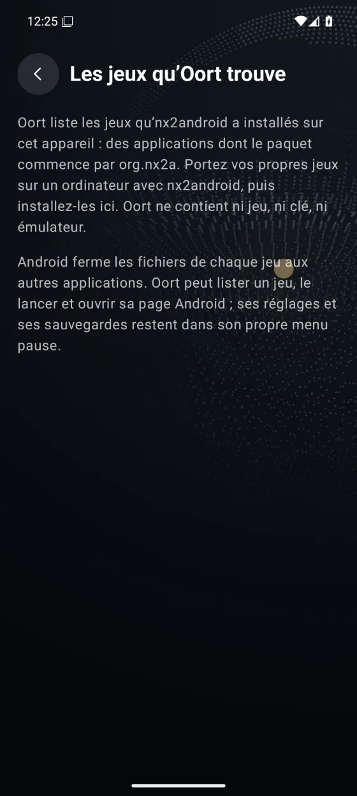
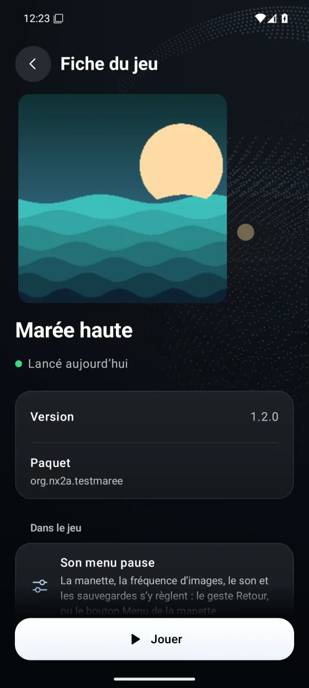
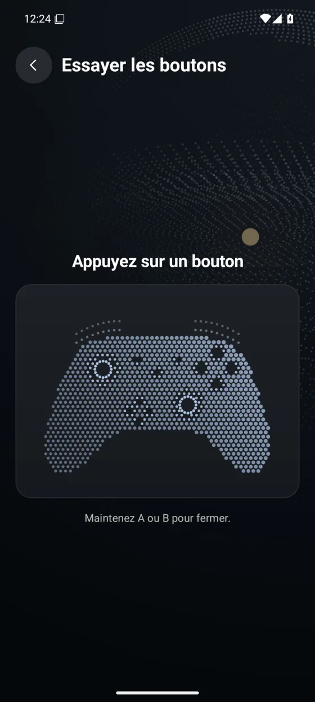
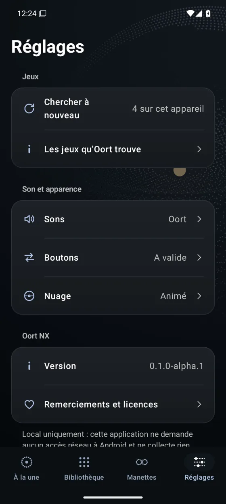

## Un jeu n’apparaît pas
<!-- step missing checked 1aaff5c0:android/tools/emulator_check.py 1aaff5c0:android/app/src/main/kotlin/io/github/sofianbll/oortnx/core/GameScanner.kt -->
Oort voit seulement les apps dont le paquet commence par `org.nx2a.`. **Réglages › Chercher à nouveau**, puis vérifie **Les jeux qu’Oort trouve**.

## Un jeu ne démarre pas
<!-- step start code 1aaff5c0:android/app/src/main/res/values/strings.xml 1aaff5c0:android/app/src/main/kotlin/io/github/sofianbll/oortnx/core/GameLauncher.kt -->
Lance-le depuis l’écran d’accueil d’Android. S’il échoue aussi là, le problème vient du jeu.

## La manette répond mal
<!-- step pad checked 1aaff5c0:android/tools/emulator_check.py -->
Ouvre **Manettes › Essayer les boutons**. Si A et B sont inversés, active **Inverser A et B**.

## Raconte le problème
<!-- step report code 1aaff5c0:SECURITY.md 1aaff5c0:CONTRIBUTING.md -->
[Ouvre un signalement](https://github.com/sofianbll/oort-nx/issues) avec ton appareil, ta version d’Android et celle d’Oort. Ni jeu, ni clé, ni sauvegarde.

