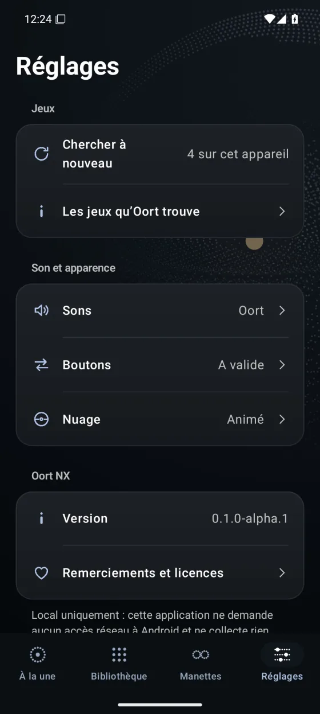

## Regarde ta version
<!-- step check code 1aaff5c0:android/README.md 1aaff5c0:android/app/src/main/AndroidManifest.xml -->
Elle est dans **Réglages**. L’app n’a pas accès au réseau : elle ne peut pas chercher de mise à jour.

## Installe le nouvel APK
<!-- step over code 1aaff5c0:android/app/build.gradle.kts https://github.com/sofianbll/oort-nx/releases/tag/android-v0.1.0-alpha.1 -->
Prends-le sur la [page des versions](https://github.com/sofianbll/oort-nx/releases) et ouvre-le par-dessus. Cette alpha est la première : aucune mise à jour n’a été essayée.

<!-- missing update-apk: Android qui propose de mettre à jour l’app. -->
