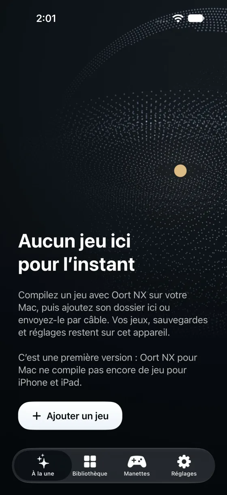
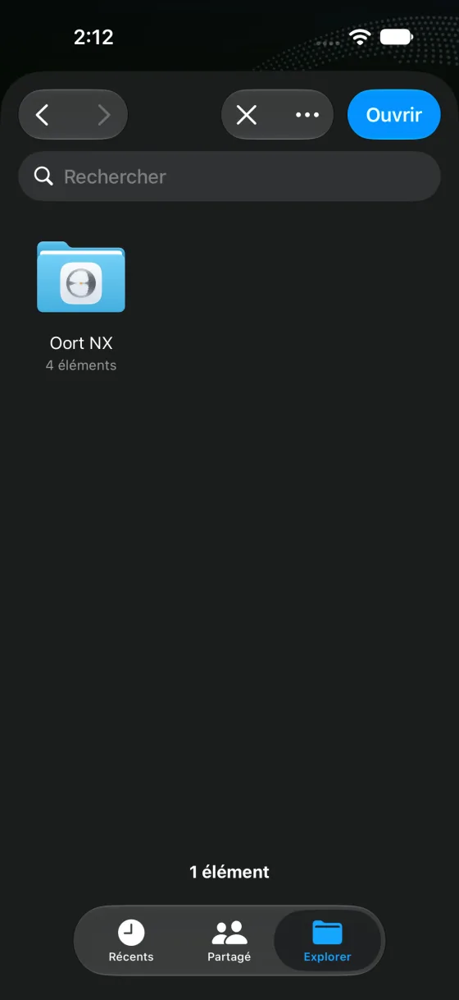
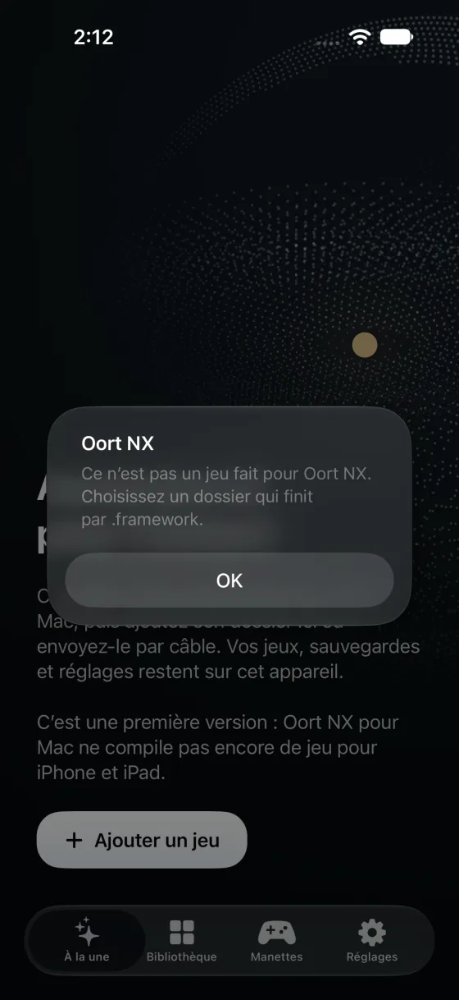

## Ce qu’il faut
<!-- step know code e3cd6df1:mobile/Sources/OortMobile/Resources/Localizable.xcstrings e3cd6df1:mobile/Sources/OortMobile/FrameworkImport.swift -->
Un dossier `DmGame….framework`, signé avec le même compte que l’app. Oort sur Mac ne sait pas encore en faire, et aucun vrai jeu n’a été essayé.

## Choisis le dossier
<!-- step pick checked e3cd6df1:mobile/UITests/OortUITests.swift e3cd6df1:mobile/Sources/OortMobile/FrameworkImport.swift -->
**Ajouter un jeu**, puis le dossier dans Fichiers. Oort le copie chez lui et laisse l’original.

## Si Oort refuse
<!-- step refused checked e3cd6df1:mobile/UITests/OortUITests.swift -->
Il dit pourquoi : ce n’est pas un jeu, il manque de la place ou la signature diffère. Rien n’a changé.

