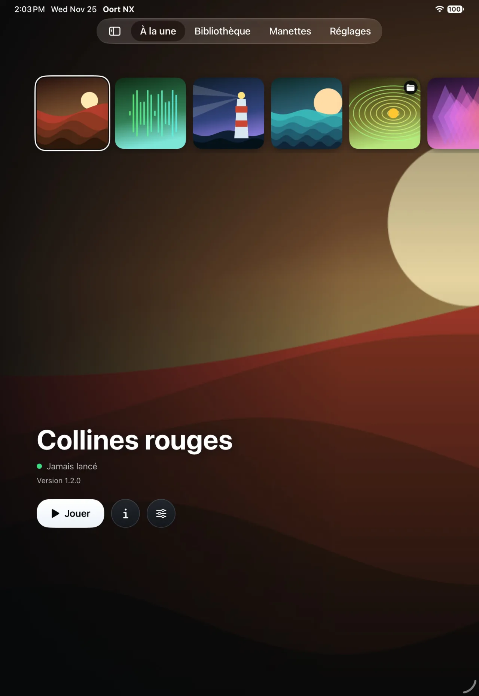
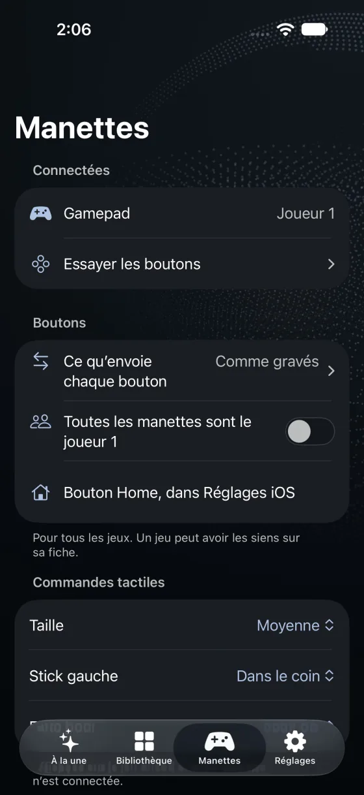
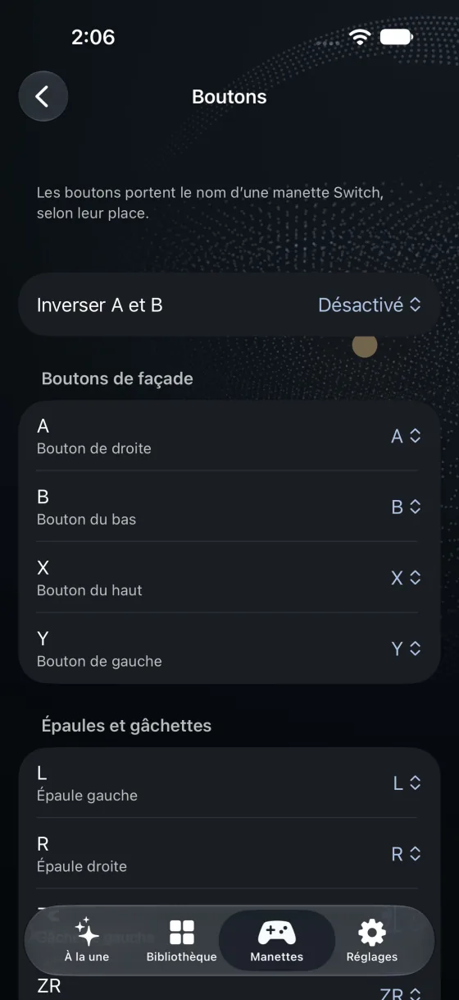

## Au doigt
<!-- step touch checked e3cd6df1:mobile/UITests/OortUITests.swift -->
Debout, couché, sur iPad, et avec de très grands textes.

## À la manette
<!-- step pad checked e3cd6df1:mobile/UITests/OortUITests.swift e3cd6df1:mobile/Sources/OortMobile/OortNav.swift e3cd6df1:mobile/Sources/ShellControllers/PadMapping.swift -->
Associe-la dans Réglages iOS › Bluetooth. A ouvre, B revient, L et R changent d’onglet. Vérifié avec une manette simulée.

## Change les boutons
<!-- step map checked e3cd6df1:mobile/UITests/OortUITests.swift e3cd6df1:mobile/Sources/OortMobile/ControllersScreen.swift -->
**Manettes › Ce qu’envoie chaque bouton**, pour tous les jeux ou sur la fiche d’un seul. Pas essayé dans un vrai jeu.

## Commandes tactiles en jeu
<!-- step onscreen code e3cd6df1:mobile/Sources/OortMobile/ControllersScreen.swift https://github.com/sofianbll/oort-nx/releases/tag/ios-v0.1.0-alpha.1 -->
Leurs réglages sont là (taille, stick, 2D ou 3D), mais elles attendent le moteur.

