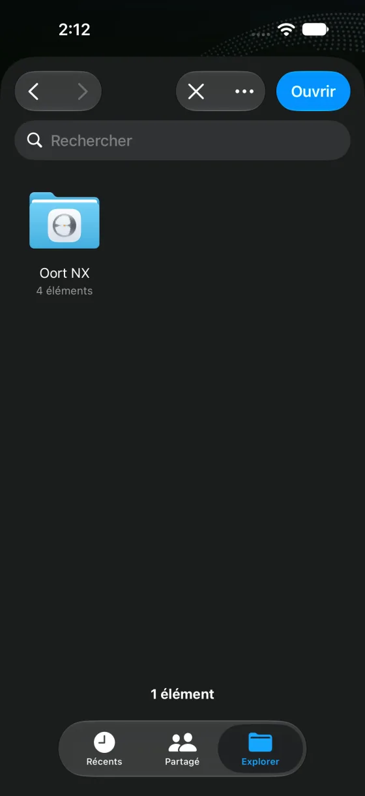
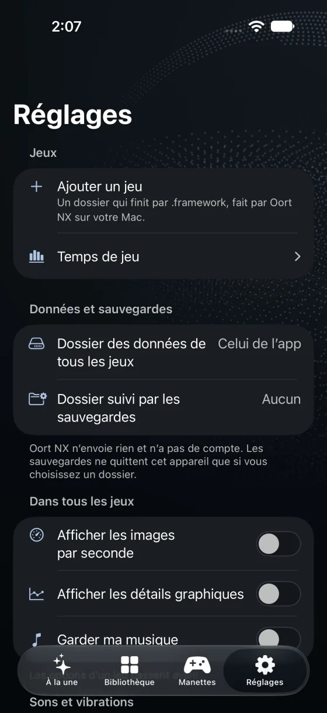

## Lit
<!-- step reads code e3cd6df1:mobile/Sources/OortMobile/FrameworkImport.swift e3cd6df1:mobile/PROVENANCE.md -->
Les jeux que tu ajoutes, et les dossiers de Fichiers que tu choisis.

## Écrit
<!-- step writes code e3cd6df1:mobile/Sources/OortMobile/FrameworkImport.swift e3cd6df1:mobile/Sources/ShellHost/PlayHistoryStore.swift -->
Son propre dossier, visible dans Fichiers : jeux, sauvegardes, réglages et temps de jeu. Plus le dossier de sauvegardes que tu as choisi.

## Envoie
<!-- step sends code e3cd6df1:mobile/PROVENANCE.md e3cd6df1:mobile/Sources/OortMobile/Resources/Localizable.xcstrings -->
Rien : aucune requête réseau, aucun compte. L’outil qui signe l’app, lui, parle à Apple avec ton compte.

