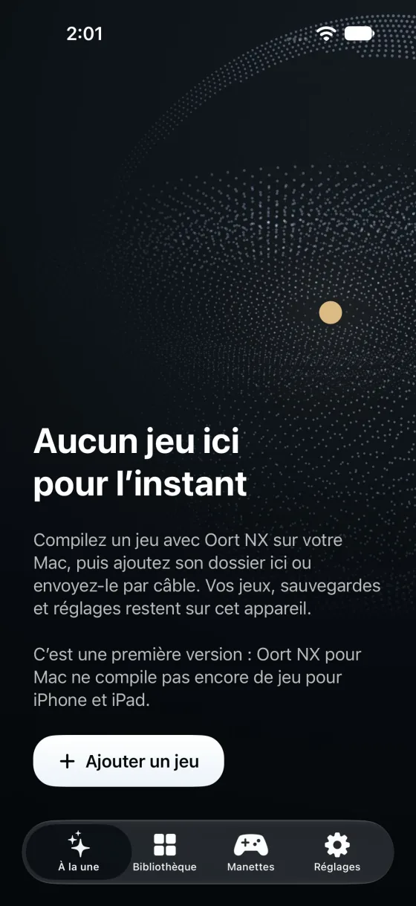
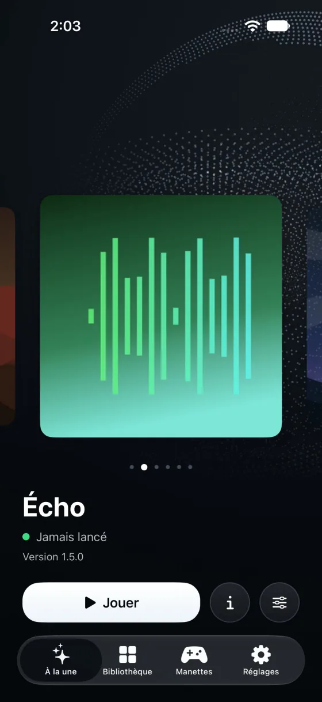
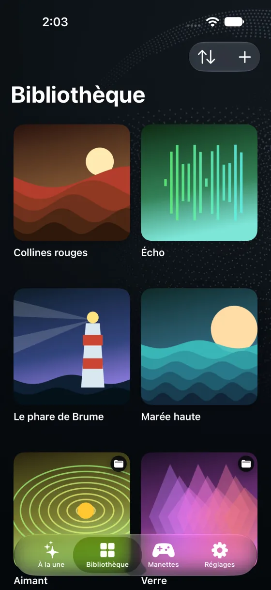

## Une bibliothèque vide
<!-- step empty checked e3cd6df1:mobile/UITests/OortUITests.swift e3cd6df1:mobile/Sources/OortMobile/Resources/Localizable.xcstrings -->
L’app ne contient aucun jeu, et le dit. **Ajouter un jeu** ouvre Fichiers.

## À la une
<!-- step home checked e3cd6df1:mobile/UITests/OortUITests.swift -->
Glisse la grande image. **Jouer** est dessous, la fiche et les options à côté.

## La bibliothèque
<!-- step tabs checked e3cd6df1:mobile/UITests/OortUITests.swift e3cd6df1:mobile/Sources/OortMobile/LibraryView.swift -->
Cherche en haut, trie par dernière partie ou par nom, et ajoute avec **+**.

