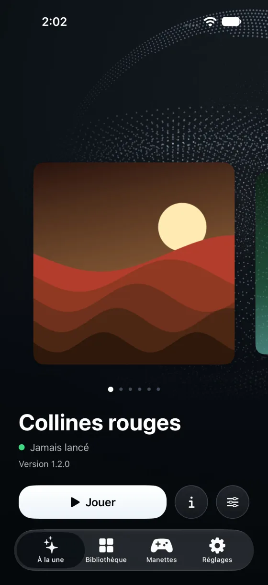

## Lis avant
<!-- step risk elsewhere https://sideinstaller.net https://altload.org -->
[SideInstaller](https://sideinstaller.net) et [AltLoad](https://altload.org) te font lancer une commande qui télécharge un programme, puis taper ton mot de passe Apple. Utilise un compte secondaire, et seulement leurs sites officiels.

<!-- missing official-site: La page officielle, adresse visible. -->

## Installe les apps gratuites
<!-- step apps elsewhere https://sideinstaller.net/install.html https://altload.org/apple-id.html -->
SideInstaller demande **LocalDevVPN** et **Open Minis** ; AltLoad ajoute **rootshell**. Elles sont sur l’App Store. Il faut aussi le Wi-Fi et le mode développeur.

<!-- missing alone-apps: Les apps sur l’écran d’accueil. -->

## Avec SideInstaller
<!-- step side elsewhere https://sideinstaller.net/install.html -->
Suis sa [page d’installation](https://sideinstaller.net/install.html). Choisis ensuite **Custom .ipa** et donne le fichier d’Oort NX, ou SideStore d’abord.

<!-- missing sideinstaller: SideInstaller, choix Custom .ipa. -->

## Ou avec AltLoad
<!-- step alt elsewhere https://altload.org/apple-id.html -->
Suis [Apple ID Install](https://altload.org/apple-id.html), pas Direct Install : celui-ci utilise un certificat partagé et un profil DNS, et peut s’arrêter sans prévenir.

<!-- missing altload: AltLoad, étapes cochées. -->

## iOS 26
<!-- step older elsewhere https://sideinstaller.net -->
Il faut un fichier d’appairage fait une fois sur un ordinateur : prends plutôt le [guide iloader](install-iloader.md).

