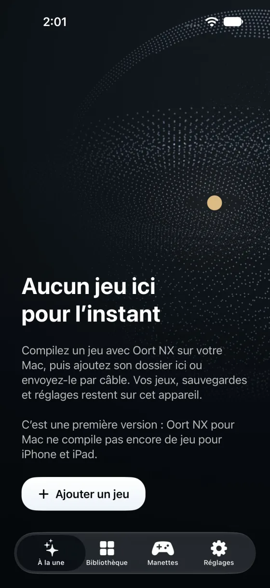

## Prépare l’iPhone
<!-- step vpn elsewhere https://docs.sidestore.io/docs/installation/prerequisites -->
Il lui faut un code et le Wi-Fi. Installe **LocalDevVPN** depuis l’App Store et connecte-le : [préparation SideStore](https://docs.sidestore.io/docs/installation/prerequisites).

<!-- missing localdevvpn: LocalDevVPN connecté. -->

## Installe iloader
<!-- step iloader elsewhere https://iloader.app -->
Prends-le seulement sur [iloader.app](https://iloader.app) ou son dépôt GitHub. Sous Windows il faut iTunes ; sous Linux, usbmuxd.

<!-- missing iloader: La fenêtre d’iloader. -->

## Installe SideStore
<!-- step sidestore elsewhere https://docs.sidestore.io/docs/installation/install -->
Branche l’iPhone, ouvre iloader et connecte-toi avec le compte secondaire. Choisis l’appareil, puis **Install SideStore (Stable)**.

<!-- missing iloader-install: iloader, appareil choisi. -->

## Fais confiance
<!-- step trust elsewhere https://docs.sidestore.io/docs/installation/install -->
Sur l’iPhone : **Réglages › Général › VPN et gestion de l’appareil**, ton compte, puis **Faire confiance**. Ensuite **Confidentialité et sécurité › Mode développeur** : l’appareil redémarre.

<!-- missing trust: Les deux pages des Réglages iOS. -->

## Termine SideStore
<!-- step refresh elsewhere https://docs.sidestore.io/docs/installation/install -->
Connecte LocalDevVPN, ouvre SideStore avec le même compte, puis dans **My Apps** touche **7 DAYS** une première fois.

<!-- missing sidestore: SideStore, onglet My Apps. -->

## Ajoute Oort NX
<!-- step oort elsewhere https://github.com/sofianbll/oort-nx/releases/tag/ios-v0.1.0-alpha.1 https://docs.sidestore.io/docs/faq -->
Télécharge `Oort-NX-iOS-0.1.0-alpha.1-unsigned.ipa` sur la [page de la version](https://github.com/sofianbll/oort-nx/releases/tag/ios-v0.1.0-alpha.1) et ajoute-le dans SideStore. Il prend une place sur les trois d’un compte gratuit.

<!-- missing sidestore-ipa: SideStore pendant l’ajout de l’IPA. -->

## Ouvre Oort NX
<!-- step open checked e3cd6df1:mobile/UITests/OortUITests.swift -->
La première page dit qu’il n’y a pas encore de jeu. C’est normal.

