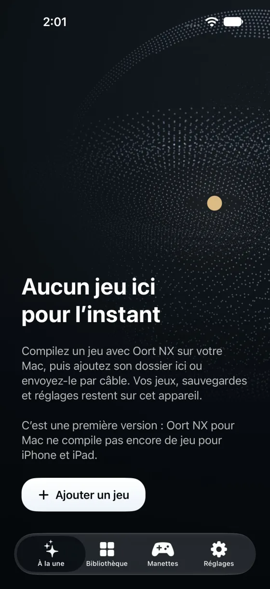
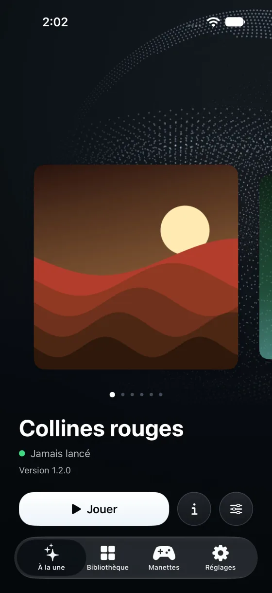

## Avant tout : à regarder, pas encore à jouer
<!-- step know code e3cd6df1:mobile/App/project.yml e3cd6df1:mobile/Sources/OortMobile/Resources/Localizable.xcstrings https://github.com/sofianbll/oort-nx/releases/tag/ios-v0.1.0-alpha.1 -->
Cette alpha ne contient aucun jeu, et Oort sur Mac n’en fabrique pas encore pour iPhone. Il faut iOS ou iPadOS 26 ou plus récent.

## Prends un compte Apple secondaire
<!-- step account elsewhere https://docs.sidestore.io/docs/faq https://iloader.app -->
L’app n’est pas signée : tu la signes avec un compte Apple, saisi dans un outil qui n’est pas d’Apple. Notre conseil est un compte créé pour ça. Un compte gratuit signe pour 7 jours, et pour 3 apps à la fois.

<!-- missing apple-account: La connexion dans l’outil, avec un compte inventé. -->

## Choisis
<!-- step choose elsewhere https://docs.sidestore.io/docs/installation/prerequisites https://iloader.app https://sideinstaller.net https://altload.org -->
Un ordinateur Windows, Linux ou Mac sous la main : [guide iloader](install-iloader.md). Aucun ordinateur et iOS 27 ou plus récent : [guide sans ordinateur](install-alone.md).

