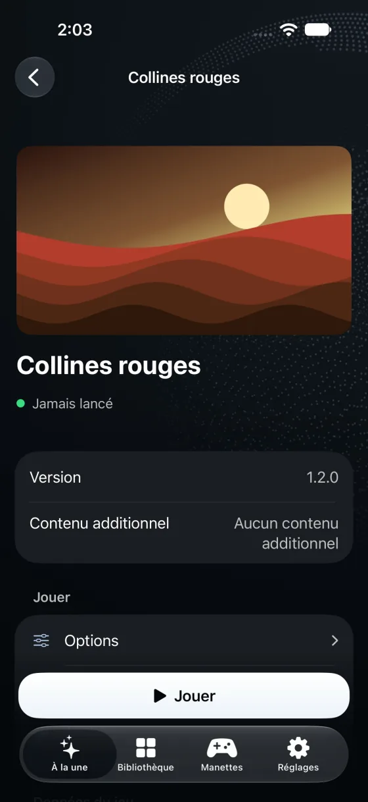
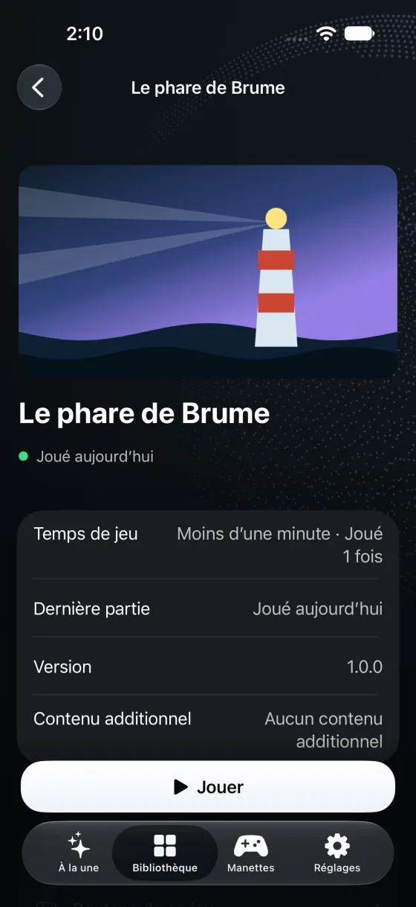

## Lance
<!-- step play checked e3cd6df1:mobile/UITests/OortUITests.swift -->
Touche **Jouer** sur la fiche.

## Pendant la partie
<!-- step in-game checked e3cd6df1:mobile/UITests/OortUITests.swift -->
Vérifié avec un jeu inventé seulement. Le retour depuis un vrai jeu attend le moteur.

## Reviens
<!-- step back checked e3cd6df1:mobile/UITests/OortUITests.swift e3cd6df1:mobile/Sources/OortMobile/SettingsScreens.swift -->
Le temps de jeu est compté sur cet appareil, dans **Réglages › Temps de jeu**.

