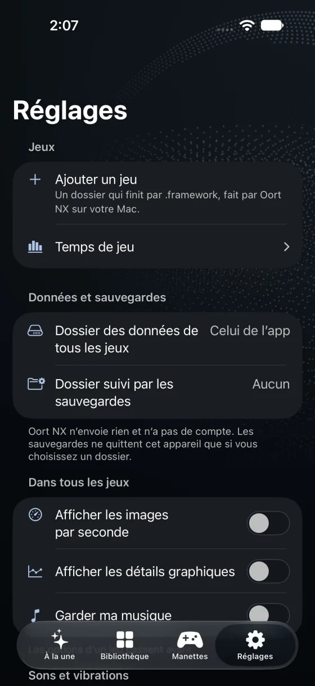

## Où elles sont
<!-- step where code e3cd6df1:mobile/Sources/OortMobile/GameScreens.swift -->
Dans Fichiers : Sur mon iPhone, Oort NX, `games`, le jeu, `save`.

## Suivre un dossier
<!-- step follow code e3cd6df1:mobile/Sources/OortMobile/GameScreens.swift e3cd6df1:mobile/Sources/ShellHost/CloudSaveSyncCheck.swift -->
Tu peux choisir un dossier de Fichiers que les sauvegardes suivent, iCloud Drive par exemple. Rien n’en sort sinon. Pas essayé en vrai.

## Avant de retirer un jeu
<!-- step copy code e3cd6df1:mobile/Sources/OortMobile/Resources/Localizable.xcstrings -->
Choisis **Retirer le jeu, garder ses sauvegardes**. Une sauvegarde supprimée ne revient pas.

