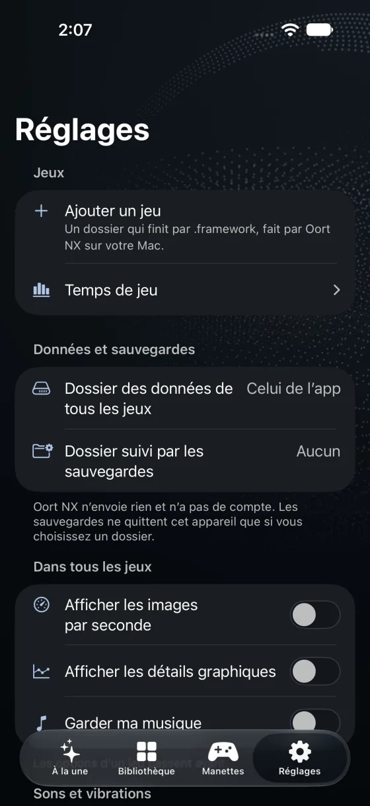
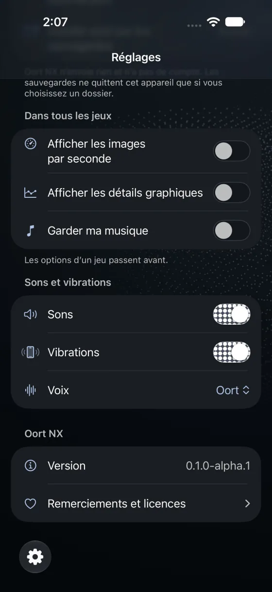
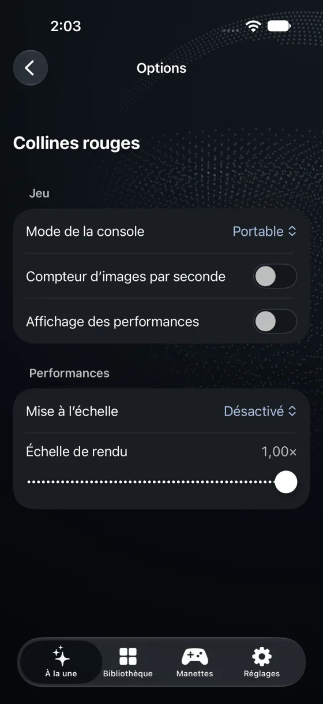

## La page Réglages
<!-- step all checked e3cd6df1:mobile/UITests/OortUITests.swift e3cd6df1:mobile/Sources/OortMobile/SettingsScreens.swift -->
Ajouter un jeu, temps de jeu, dossiers, options communes à tous les jeux.

## Sons et vibrations
<!-- step sounds checked e3cd6df1:mobile/UITests/OortUITests.swift e3cd6df1:mobile/Sources/OortMobile/SettingsScreens.swift -->
Coupe-les ou change de voix. Pas écoutés sur un vrai appareil.

## Options d’un jeu
<!-- step game checked e3cd6df1:mobile/UITests/OortUITests.swift e3cd6df1:mobile/Sources/OortMobile/GameScreens.swift -->
Elles viennent du jeu lui-même, et passent avant les réglages communs.

