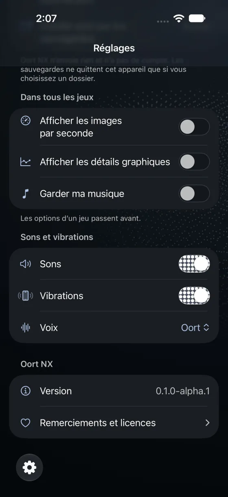
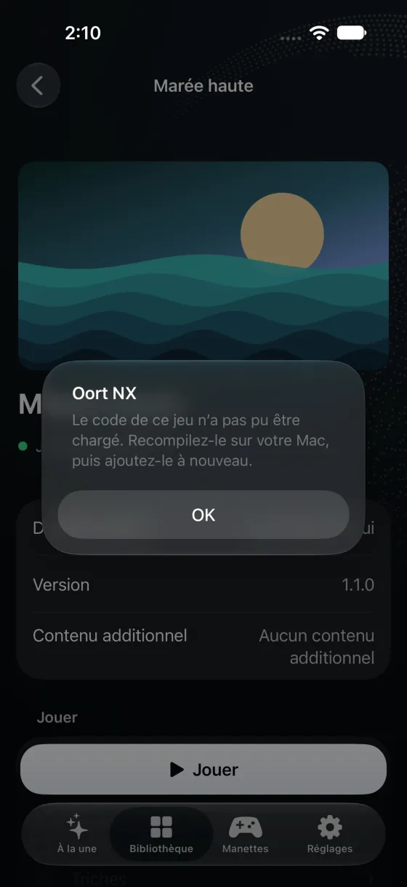
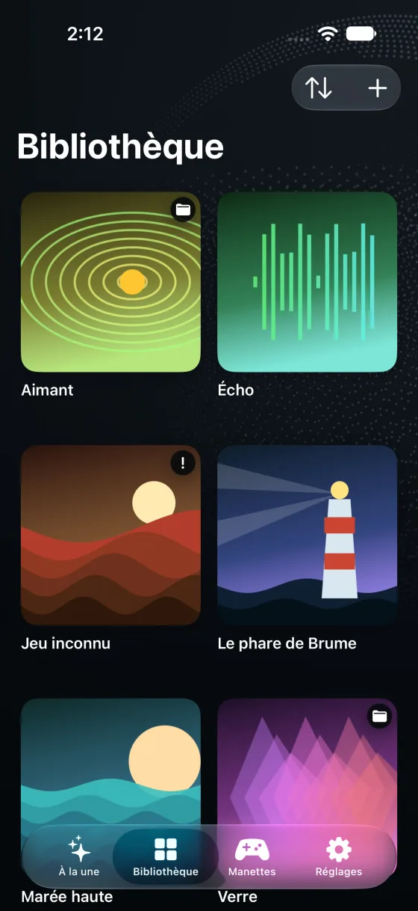

## L’app ne s’ouvre plus
<!-- step expired code e3cd6df1:mobile/Sources/OortMobile/SettingsScreens.swift e3cd6df1:mobile/Sources/ShellHost/ProvisioningProfile.swift -->
Sa signature a sans doute expiré. Rafraîchis-la avec le même compte ; tes jeux et sauvegardes doivent rester. Pas essayé.

## Le code du jeu est refusé
<!-- step code checked e3cd6df1:mobile/UITests/OortUITests.swift -->
Il n’est pas signé comme l’app, ou il est abîmé.

## Un jeu porte un point d’exclamation
<!-- step damaged checked e3cd6df1:mobile/UITests/OortUITests.swift -->
Sa fiche dit ce qui manque. Ajoute-le à nouveau.

## Raconte le problème
<!-- step report code e3cd6df1:SECURITY.md e3cd6df1:CONTRIBUTING.md -->
[Ouvre un signalement](https://github.com/sofianbll/oort-nx/issues) avec ton appareil, ta version d’iOS et celle d’Oort. Ni jeu, ni clé, ni sauvegarde.

