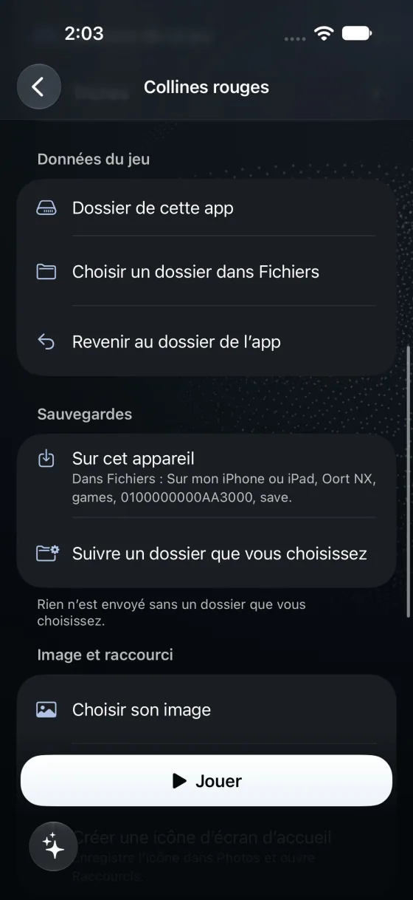
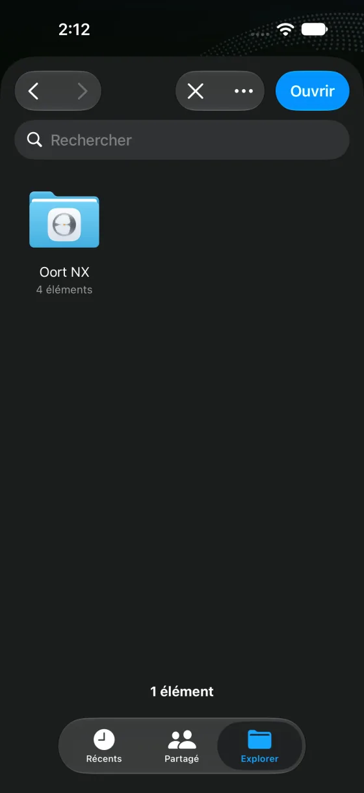

## Retirer un jeu
<!-- step game code e3cd6df1:mobile/Sources/OortMobile/GameScreens.swift e3cd6df1:mobile/Sources/OortMobile/Resources/Localizable.xcstrings -->
Sur sa fiche, **Retirer de cet appareil**, avec ou sans ses sauvegardes.

## Retirer l’app
<!-- step app code e3cd6df1:mobile/App/project.yml e3cd6df1:mobile/Sources/OortMobile/FrameworkImport.swift -->
iOS supprime avec elle ses jeux et ses sauvegardes. Copie d’abord le dossier Oort NX depuis Fichiers.

