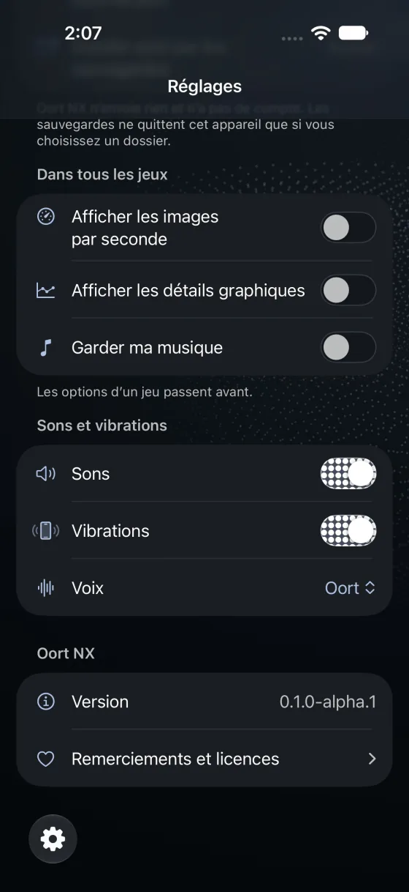

## Tous les 7 jours
<!-- step refresh elsewhere https://docs.sidestore.io/docs/installation/install https://docs.sidestore.io/docs/faq -->
Avec un compte gratuit, rafraîchis Oort NX dans SideStore, LocalDevVPN connecté. Oort prévient quand sa signature arrive à sa fin.

<!-- missing sidestore-refresh: SideStore, compteur de jours. -->

## Nouvelle version
<!-- step update code e3cd6df1:mobile/Sources/OortMobile/Resources/Localizable.xcstrings https://github.com/sofianbll/oort-nx/releases/tag/ios-v0.1.0-alpha.1 -->
Ajoute le nouvel IPA avec le même outil et le même compte, sans supprimer l’ancienne app. Cette alpha est la première : aucune mise à jour n’a été essayée.

