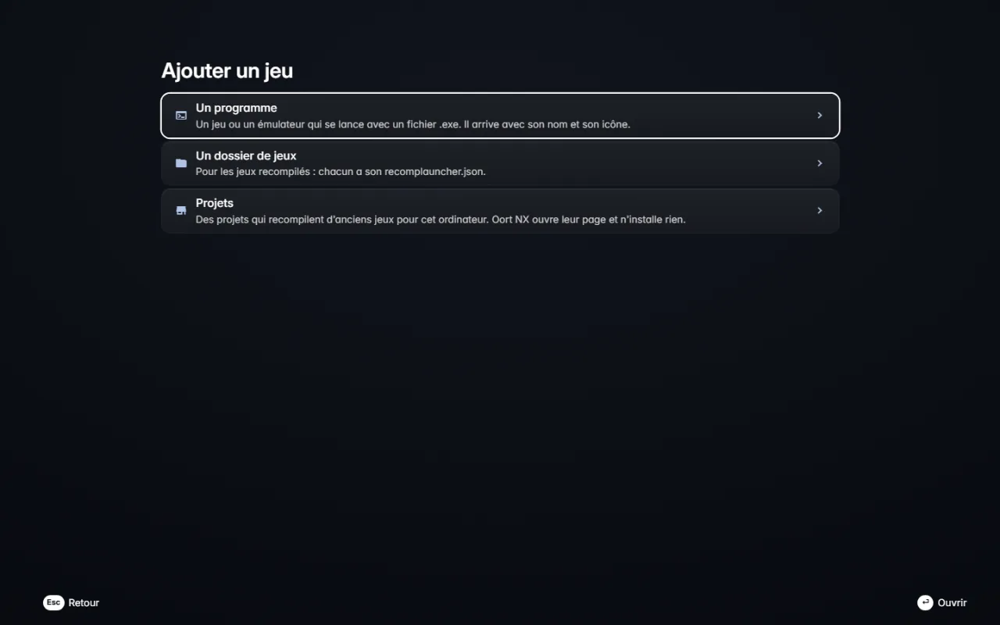
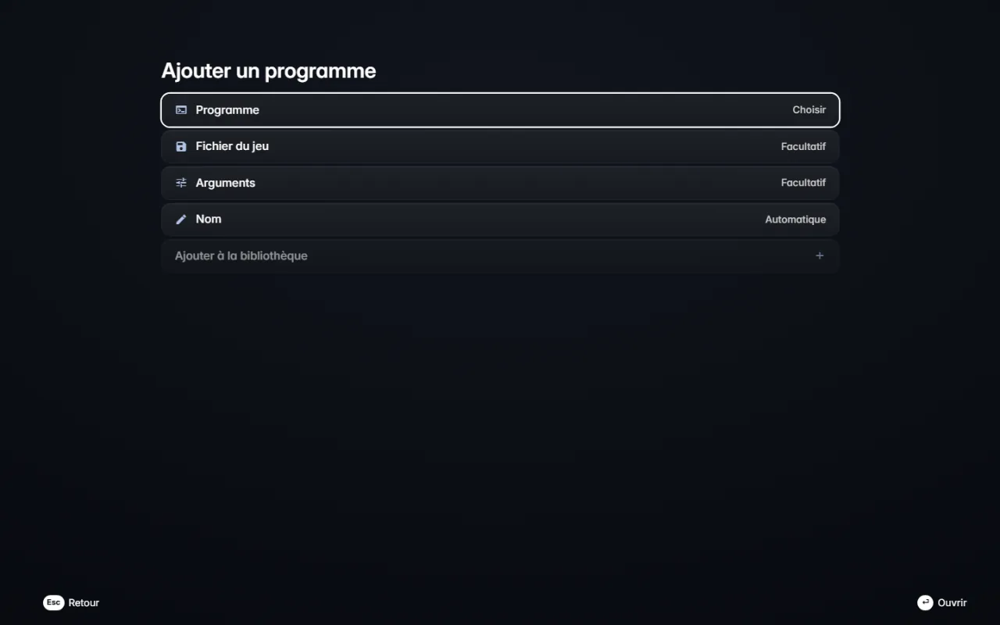

## Ouvre Ajouter un jeu
<!-- step add checked cc9db84a:desktop/ui/app.js -->
Choisis la tuile **+**, puis **Un programme**.

## Choisis le fichier
<!-- step program code cc9db84a:desktop/ui/app.js cc9db84a:Sources/OortCompanion/Launch.swift -->
**Programme** est le fichier à lancer du jeu ou de l’émulateur. Pour un émulateur, **Fichier du jeu** est le jeu qu’il doit ouvrir.

## Ajoute-le
<!-- step finish code cc9db84a:desktop/ui/app.js cc9db84a:Sources/OortCompanion/Companion.swift -->
Donne-lui un nom si tu veux, puis **Ajouter à la bibliothèque**. Dans cette version, il n’a ni icône ni jaquette : son nom s’affiche sur la tuile.

