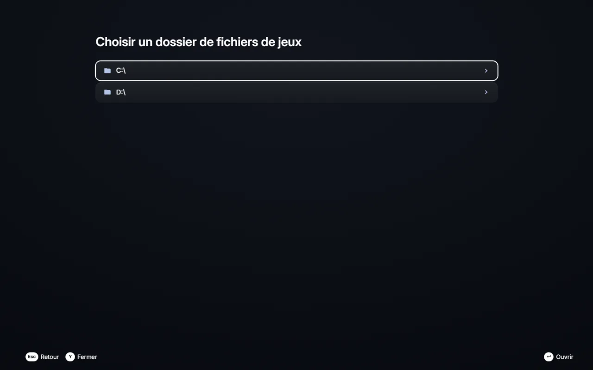
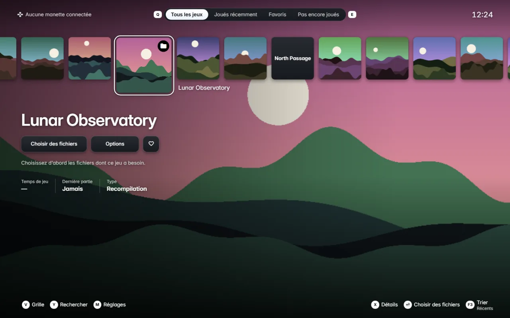
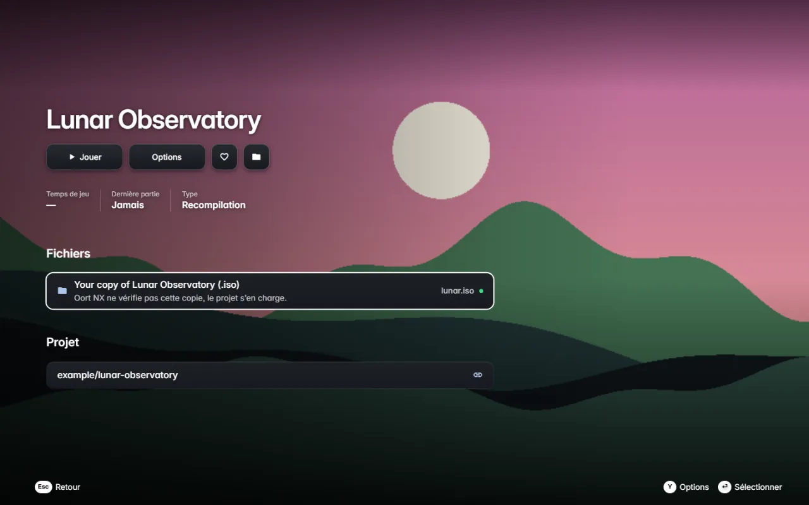
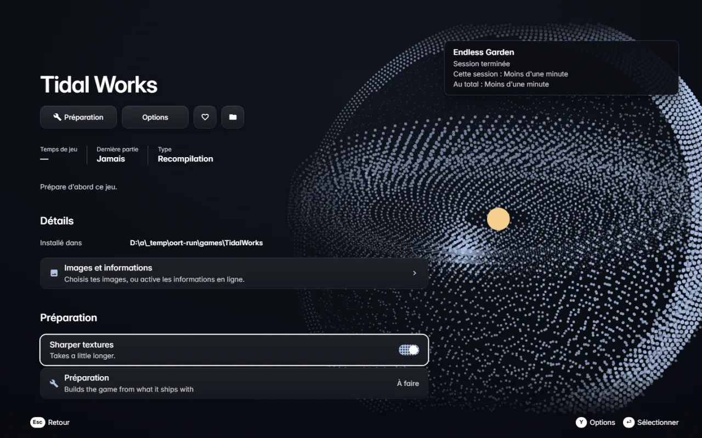

## Choisis le dossier
<!-- step folder checked f18e2119:desktop/ui/app.js f18e2119:Sources/OortCompanion/Manifest.swift -->
Tuile **+** › **Un dossier de jeux**. Chaque jeu y est un dossier avec son fichier `recomplauncher.json`.

## Regarde ce qui manque
<!-- step needs checked f18e2119:desktop/ui/app.js f18e2119:desktop/tests/walk.js -->
Si un jeu demande des fichiers, son bouton devient **Choisir des fichiers**.

## Donne ta copie
<!-- step files checked f18e2119:Sources/OortCompanion/Companion.swift f18e2119:desktop/tests/play.js -->
Sur sa page, choisis ton propre fichier. Oort retient seulement où il est, sans le copier.

## Prépare-le si besoin
<!-- step prepare checked f18e2119:desktop/ui/app.js f18e2119:desktop/tests/play.js -->
**Préparation** lance l’étape que le projet a prévue. Si elle demande de copier ou de télécharger des fichiers, il faut la faire dans le projet.

