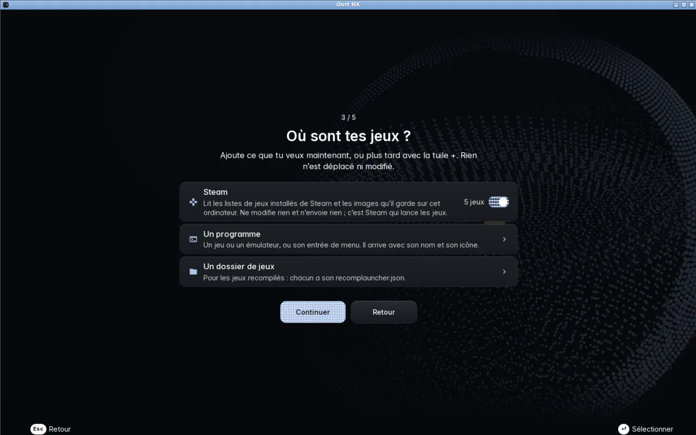

## Active Steam
<!-- step on checked f18e2119:desktop/ui/app.js f18e2119:desktop/tests/linux/prove.sh f18e2119:Sources/OortCompanion/SteamShelf.swift -->
Dans l’accueil guidé, la tuile **+** ou **Réglages › Intégrations › Steam**. Oort lit les jeux installés, sur tous les disques, et n’écrit rien chez Steam.

## Retrouve-les
<!-- step shelf checked f18e2119:desktop/ui/app.js f18e2119:desktop/tests/linux/prove.sh -->
Leurs images sont celles que Steam garde déjà sur ton ordinateur. Les outils et les bandes-son sont laissés de côté ; un jeu doit être entièrement téléchargé.

## Joue
<!-- step play checked f18e2119:desktop/ui/app.js f18e2119:desktop/tests/linux/prove.sh f18e2119:desktop/src-tauri/src/steam.rs -->
**Jouer** demande le jeu à Steam, qui le lance. S’il le met d’abord à jour, Oort attend ; **Annuler** arrête l’attente.

## Reviens
<!-- step back checked f18e2119:desktop/ui/app.js f18e2119:desktop/tests/linux/prove.sh -->
Quitte le jeu : Oort revient et compte le temps. Vérifié avec un faux Steam, jamais avec le vrai, ni avec Proton.

