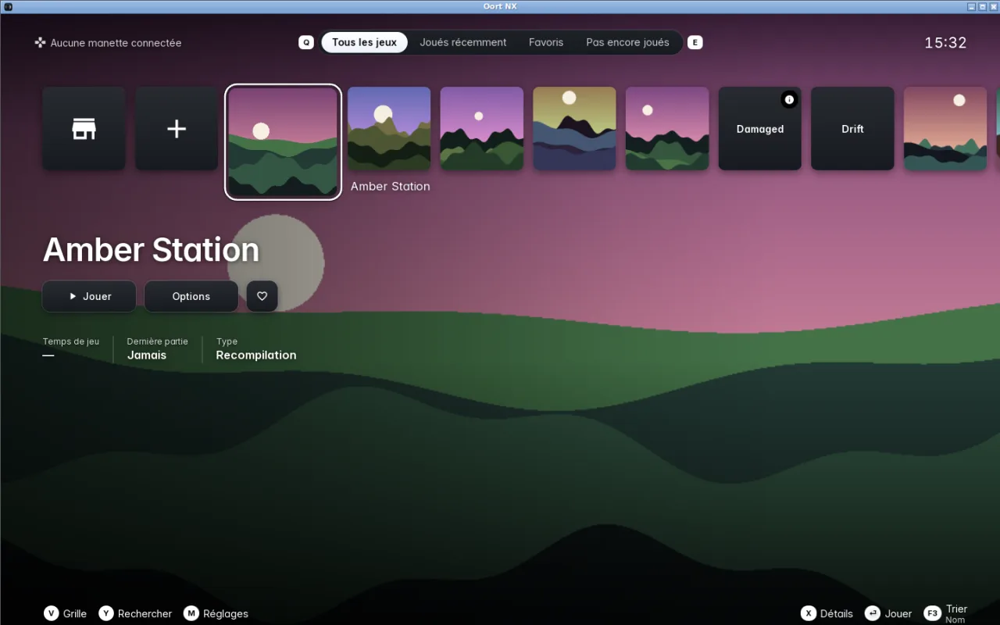
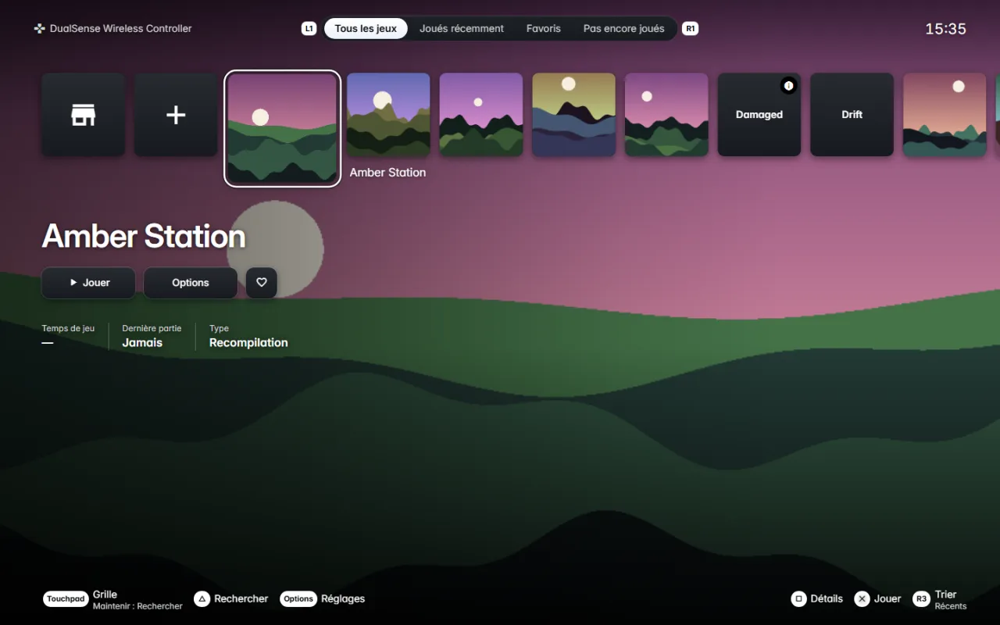
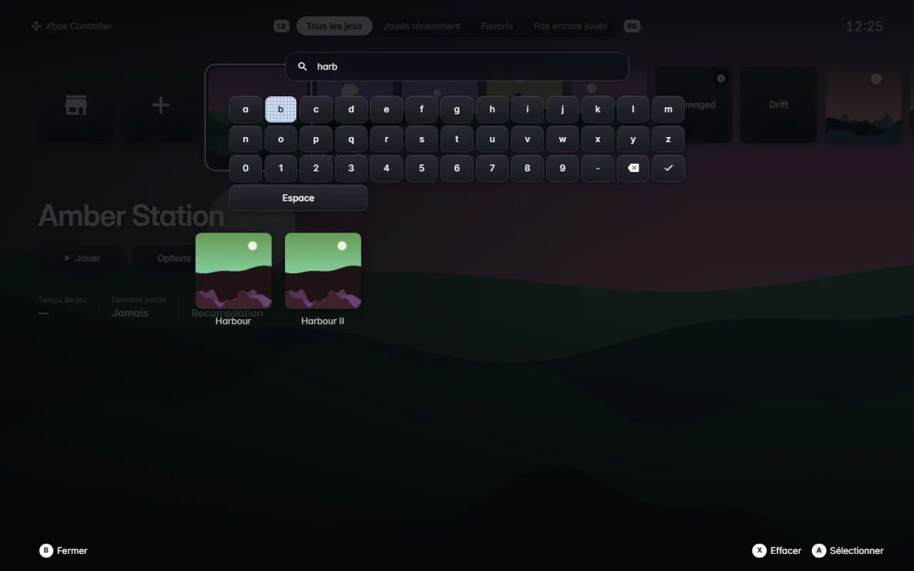
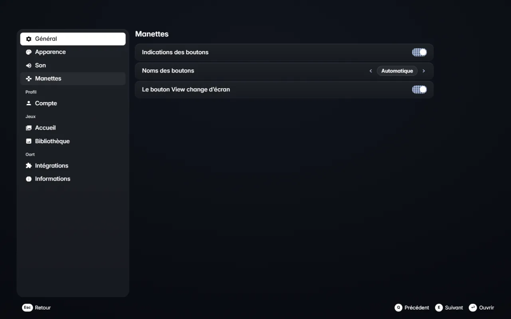

## Les touches utiles
<!-- step keys checked cc9db84a:desktop/ui/app.js cc9db84a:desktop/tests/pad.js -->
Les rappels sont en bas de l’écran.

| Action | Xbox | Clavier |
|---|---|---|
| Jouer, choisir | A | Entrée |
| Retour | B | Échap |
| Détails | X | X |
| Rechercher | Y | Y ou Ctrl F |
| Grille ou à la une | View | V |
| Changer d’onglet | LB / RB | Q / E |
| Trier | Stick droit | F3 |
| Réglages | Menu | M |
| Plein écran | | F11 |

## Ta manette
<!-- step prompts checked cc9db84a:desktop/ui/nav.js cc9db84a:desktop/tests/pad.js -->
Son nom s’affiche en haut à gauche et les rappels prennent ses boutons : Xbox, PlayStation ou Nintendo. Vérifié avec des manettes simulées, pas encore avec une vraie.

## Écrire à la manette
<!-- step type checked cc9db84a:desktop/ui/app.js cc9db84a:desktop/tests/pad.js -->
La recherche ouvre un clavier à l’écran. **X** efface.

## Changer les noms des boutons
<!-- step change checked cc9db84a:Sources/OortCompanion/SettingRows.swift -->
**Réglages › Manettes › Noms des boutons**. Changer les touches d’un jeu se fait dans le jeu.

