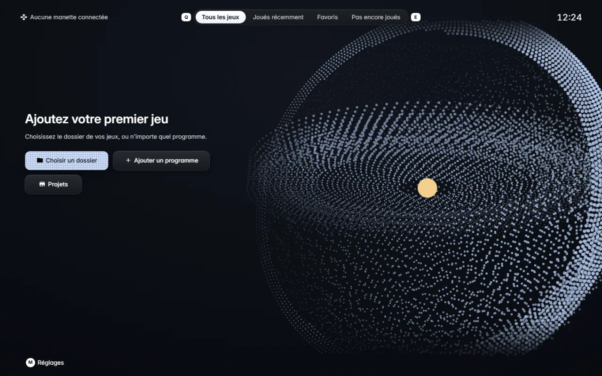
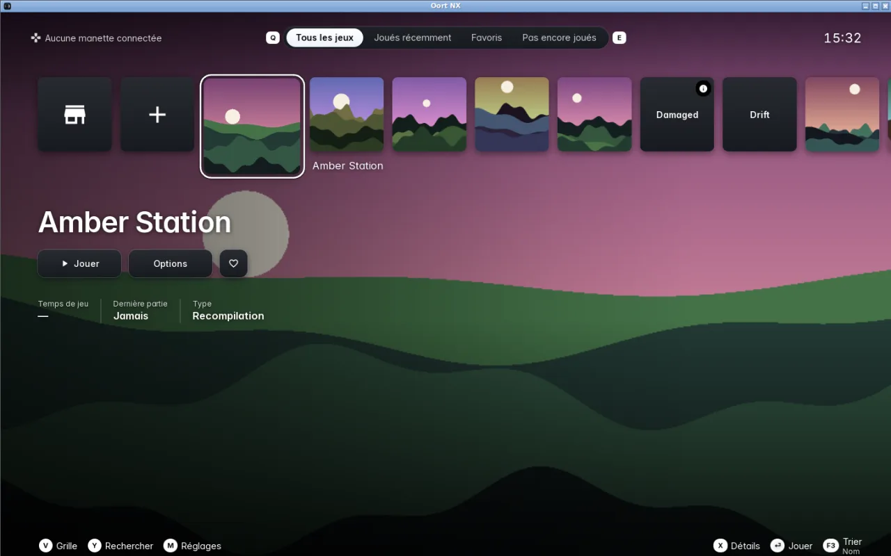
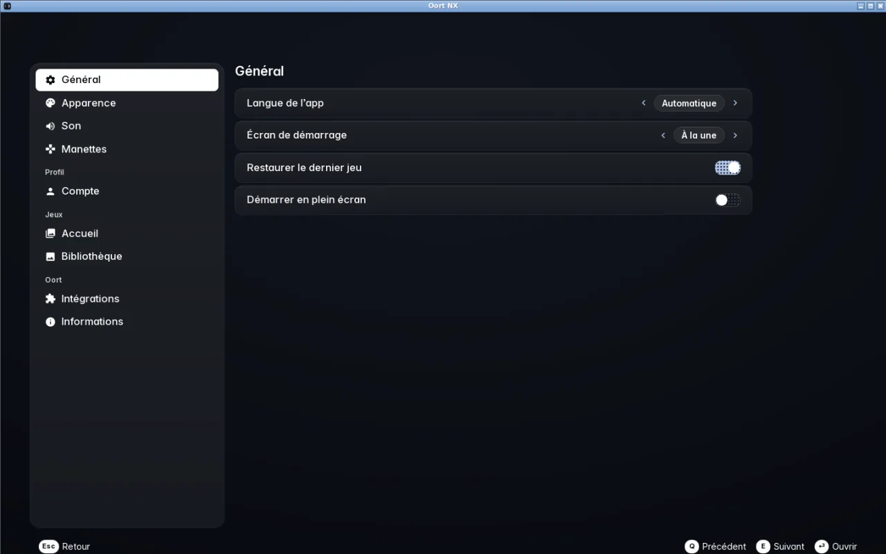

## Choisis par où commencer
<!-- step empty checked cc9db84a:desktop/ui/app.js cc9db84a:desktop/tests/first.js -->
**Choisir un dossier** pour des jeux recompilés, **Ajouter un programme** pour un jeu ou un émulateur que tu as déjà. Rien n’est téléchargé.

## Retrouve tes jeux
<!-- step home checked cc9db84a:desktop/ui/app.js cc9db84a:desktop/tests/walk.js -->
Chaque jeu est une tuile. Les deux premières tuiles ouvrent **Projets** et **Ajouter un jeu**.

## Vérifie la langue
<!-- step language checked cc9db84a:Sources/OortCompanion/SettingRows.swift -->
**Réglages › Général › Langue de l’app** : automatique, français ou anglais.

