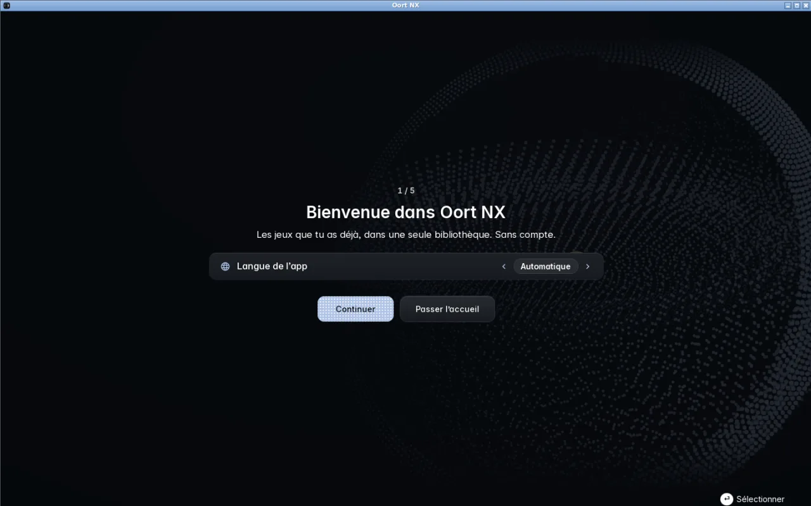

## Télécharge
<!-- step download code f18e2119:desktop/src-tauri/tauri.conf.json https://github.com/sofianbll/oort-nx/releases/tag/windows-v0.1.0-alpha.2 -->
Prends `Oort-NX-Linux-0.1.0-alpha.2-x64.deb` et `SHA256SUMS` sur la [page de la version](https://github.com/sofianbll/oort-nx/releases/tag/windows-v0.1.0-alpha.2). Il faut un Linux 64 bits qui lit les paquets .deb ; seul Ubuntu 24.04 a été essayé.

<!-- missing release-page: La page de la version sur GitHub, fichiers dépliés. -->

## Compare l’empreinte
<!-- step checksum code f18e2119:desktop/tests/linux/prove.sh https://github.com/sofianbll/oort-nx/releases/tag/windows-v0.1.0-alpha.2 -->
Dans le dossier du téléchargement, `sha256sum -c SHA256SUMS --ignore-missing` doit répondre OK. Sinon, supprime le fichier.

<!-- missing checksum: Le terminal avec l’empreinte et sa réponse. -->

## Installe le paquet
<!-- step run checked f18e2119:desktop/tests/linux/prove.sh -->
Dans le dossier du téléchargement : `sudo apt install ./Oort-NX-Linux-0.1.0-alpha.2-x64.deb`. Les bibliothèques nécessaires viennent avec.

<!-- missing apt-install: Le terminal pendant l’installation du .deb. -->

## Ouvre Oort NX
<!-- step open checked f18e2119:desktop/tests/linux/prove.sh -->
Il est dans le menu des applications. L’accueil guidé s’ouvre ; tu peux le passer.

