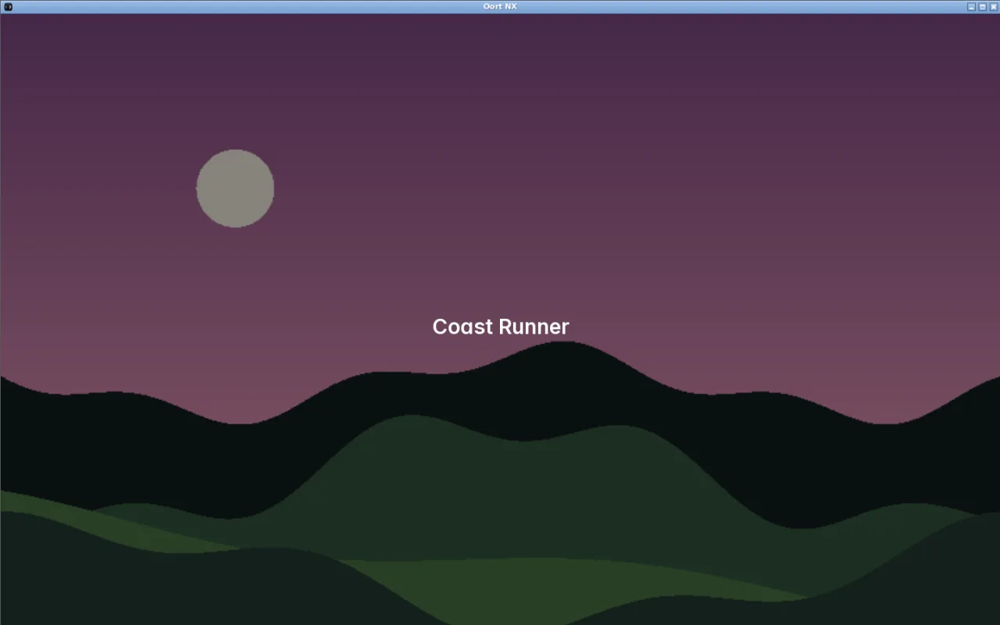
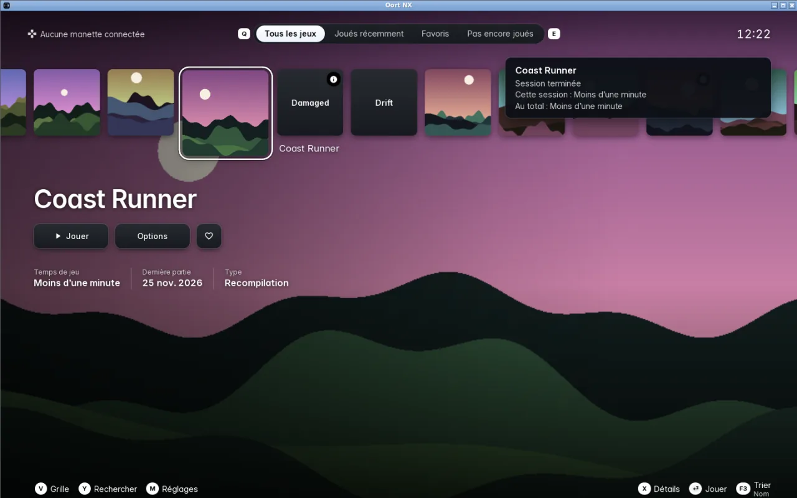
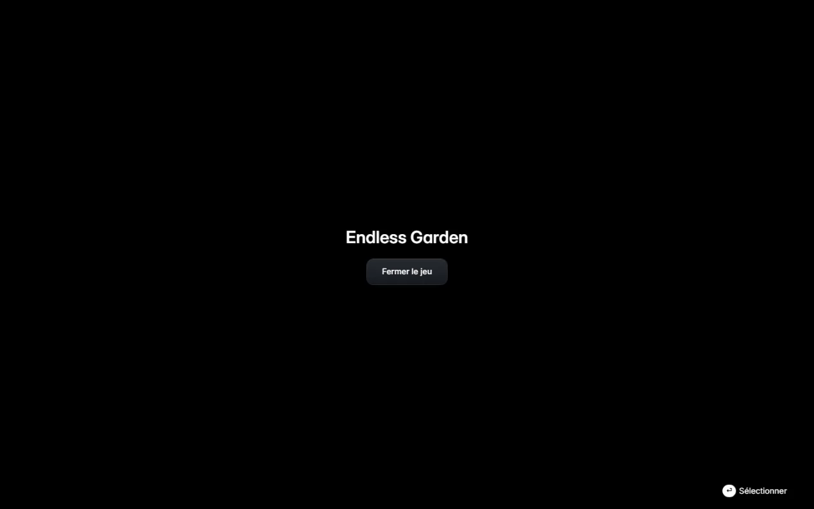

## Lance
<!-- step play checked f18e2119:desktop/src-tauri/src/lib.rs f18e2119:desktop/tests/linux/prove.sh -->
Choisis **Jouer**. L’écran montre le jeu, puis Oort se réduit.

## Reviens
<!-- step back checked f18e2119:desktop/src-tauri/src/lib.rs f18e2119:desktop/tests/linux/prove.sh -->
Quitte le jeu comme d’habitude : Oort revient devant et affiche le temps de ta partie.

## Ferme un jeu bloqué
<!-- step close checked f18e2119:desktop/ui/app.js f18e2119:desktop/tests/play.js -->
Reviens à la fenêtre d’Oort : **Fermer le jeu** apparaît au bout de quatre secondes. Ce qui n’est pas enregistré est perdu. Le bouton Home n’est pas encore pris en charge en jeu.

