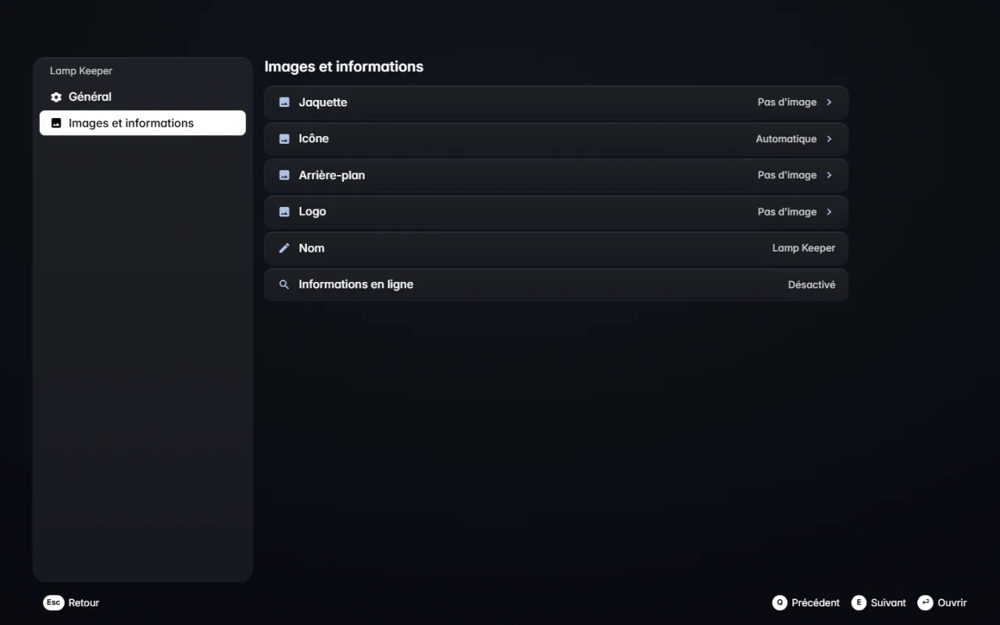
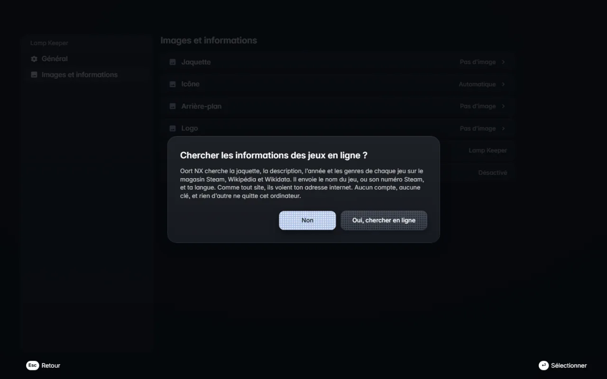
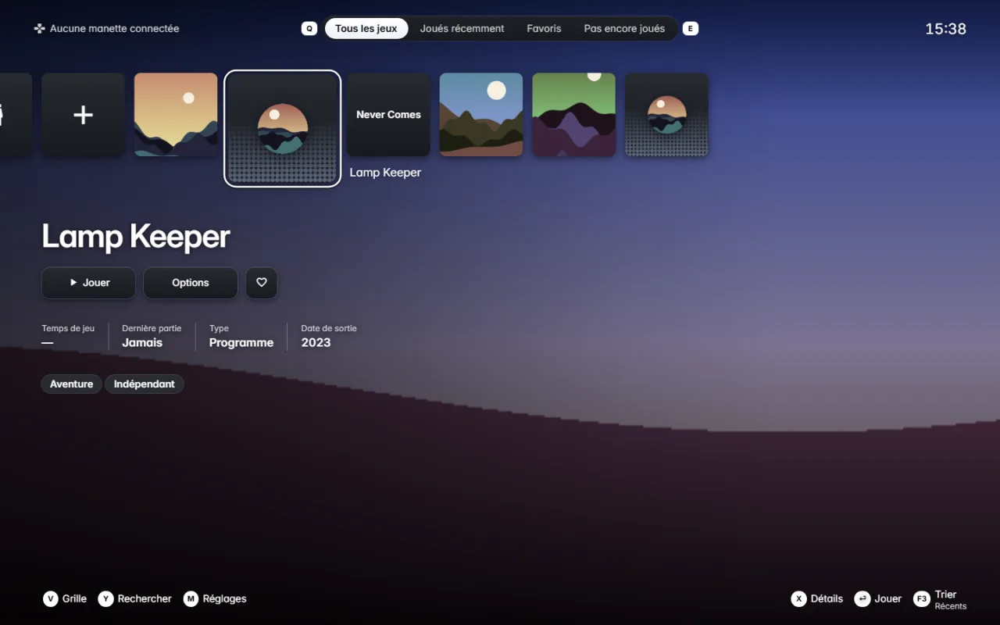
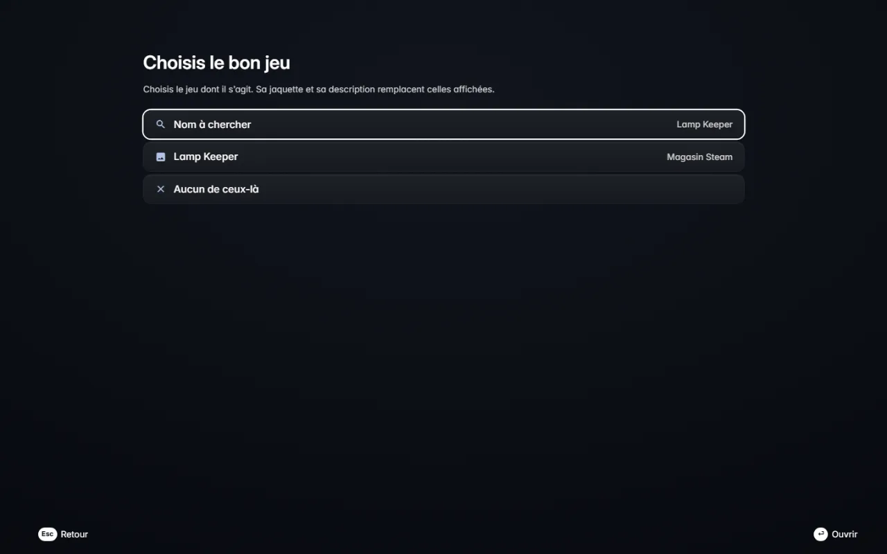
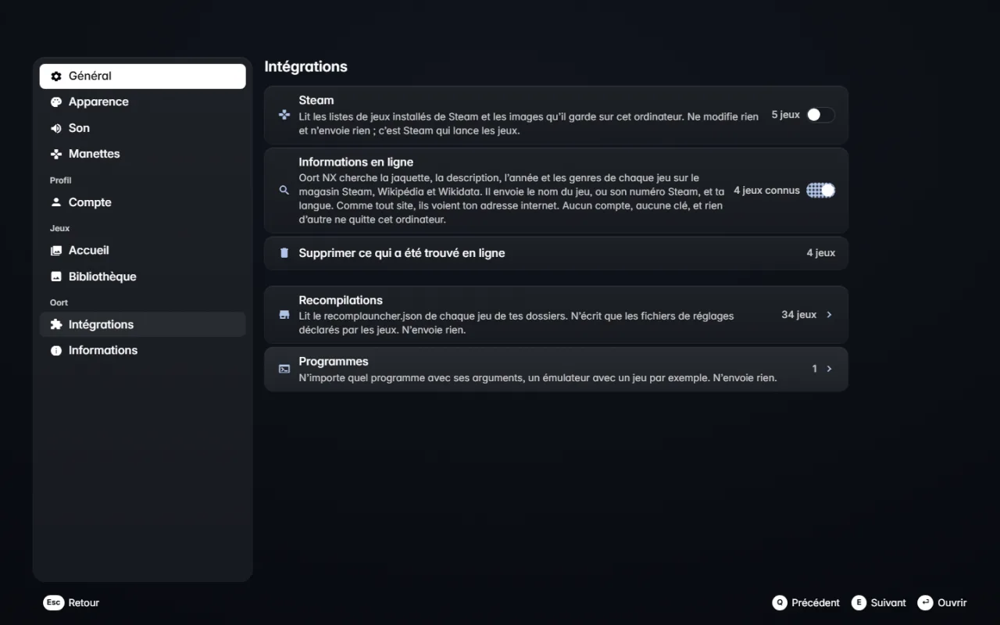

## Ouvre la page
<!-- step open code f18e2119:desktop/ui/app.js f18e2119:Sources/OortCompanion/Companion+Own.swift -->
Sur un jeu : **Options › Images et informations**.

## Choisis tes images
<!-- step own code f18e2119:desktop/ui/app.js f18e2119:Sources/OortCompanion/Companion+Own.swift f18e2119:Tests/OortCompanionTests/OwnTests.swift -->
Jaquette, icône, arrière-plan ou logo : un fichier PNG, JPEG ou WebP. Il est copié dans le dossier d’Oort ; l’original ne change pas.

## Cherche en ligne, si tu dis oui
<!-- step ask code f18e2119:desktop/ui/app.js f18e2119:Sources/OortCompanion/Online.swift -->
Oort envoie le nom du jeu ou son numéro Steam, et ta langue, au magasin Steam, à Wikidata et à Wikipédia. Vérifié sous Windows avec de faux services, jamais avec les vrais.

## Regarde ce qui est trouvé
<!-- step found code f18e2119:desktop/ui/app.js f18e2119:Sources/OortCompanion/Online.swift -->
Jaquette, description, année et genres arrivent seuls. Wikipédia limite les demandes : c’est surtout le magasin Steam qui répond.

## Corrige
<!-- step right code f18e2119:desktop/ui/app.js f18e2119:Sources/OortCompanion/Online.swift -->
Mauvais jeu ? **Informations en ligne**, puis le bon. **Aucun de ceux-là** efface ce qui vient d’internet pour ce jeu.

## Coupe ou efface
<!-- step off code f18e2119:desktop/ui/app.js f18e2119:Sources/OortCompanion/Online.swift -->
**Réglages › Intégrations** coupe les informations en ligne et supprime tout ce qui a été trouvé. Tes images restent.

