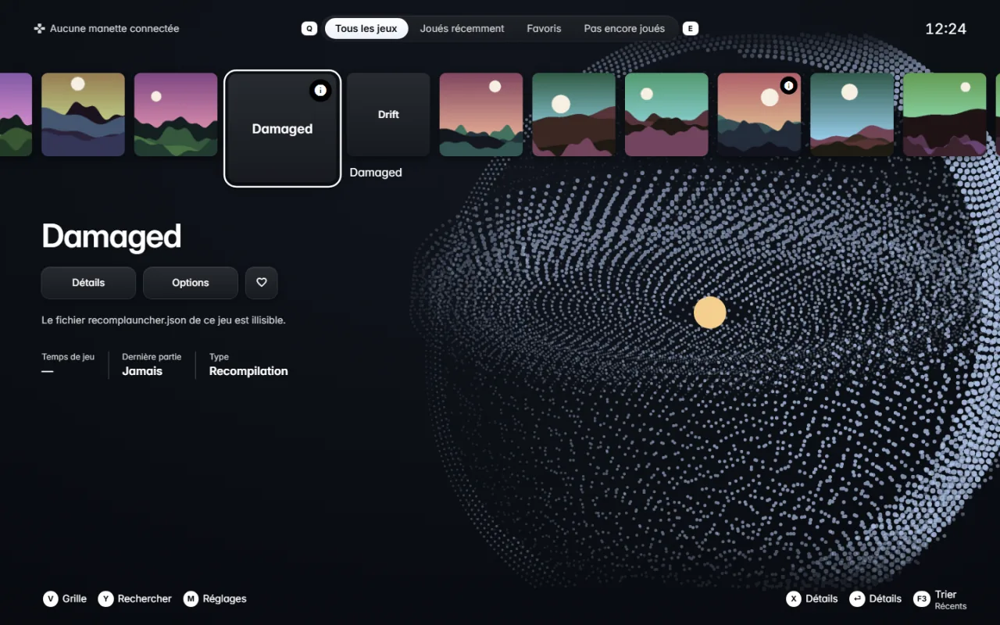

## Il manque un jeu
<!-- step missing checked cc9db84a:desktop/ui/app.js cc9db84a:Sources/OortCompanion/Companion.swift -->
**Réglages › Accueil › Relire**. Pour une recompilation, vérifie que son dossier contient `recomplauncher.json`.

## Le jeu est marqué illisible
<!-- step unreadable checked cc9db84a:desktop/ui/app.js cc9db84a:desktop/tests/walk.js -->
Son `recomplauncher.json` est abîmé ou demande un lanceur plus récent. Reprends-le dans le projet.

## Le jeu s’arrête
<!-- step crash checked cc9db84a:desktop/src-tauri/src/lib.rs cc9db84a:desktop/tests/play.js -->
Oort montre le message que le jeu a laissé. Vérifie ensuite que le jeu démarre seul, hors d’Oort.

## La manette n’est pas vue
<!-- step pad code cc9db84a:desktop/src-tauri/src/pad.rs cc9db84a:desktop/ui/nav.js -->
Appuie sur un bouton avec la fenêtre d’Oort devant, puis débranche et rebranche-la. Pas essayé avec une vraie manette.

## Raconte le problème
<!-- step report code cc9db84a:SECURITY.md cc9db84a:CONTRIBUTING.md -->
[Ouvre un signalement](https://github.com/sofianbll/oort-nx/issues) : ce que tu faisais, ce que tu as vu, ta version. N’y joins ni jeu, ni clé, ni sauvegarde.

