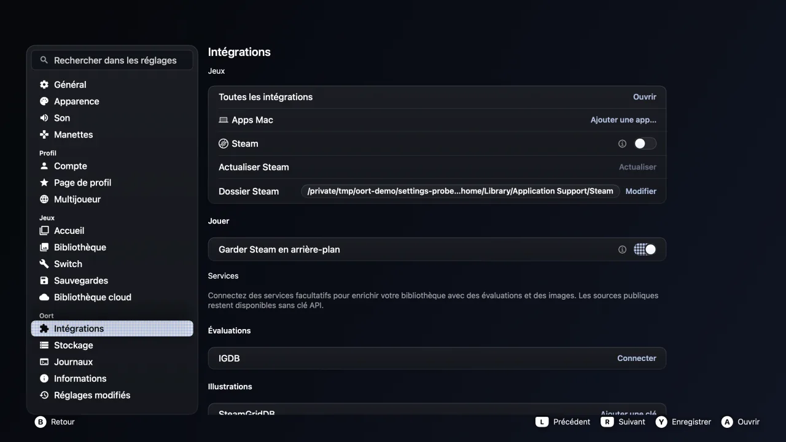

## Ajoute-la
<!-- step add checked bf0c3410:Tests/CatalogAppChecks/MacShortcutProbe.swift bf0c3410:Sources/NXLibrary/Views/Settings/SettingsSourcesSection.swift -->
**Réglages › Intégrations › Apps Mac › Ajouter une app…**, ou dépose un `.app` sur la bibliothèque.

## Ce qu’Oort fait
<!-- step what code bf0c3410:PLAYER-GUIDE.fr.md bf0c3410:Sources/NXLibraryCore/Catalog/MacShortcutRecord.swift -->
Il ouvre l’app, sans la modifier et sans compter le temps. Si elle change de place, **Retrouver l’app…**.

<!-- missing mac-app-tile: Une app Mac inventée dans la bibliothèque, options ouvertes. -->
