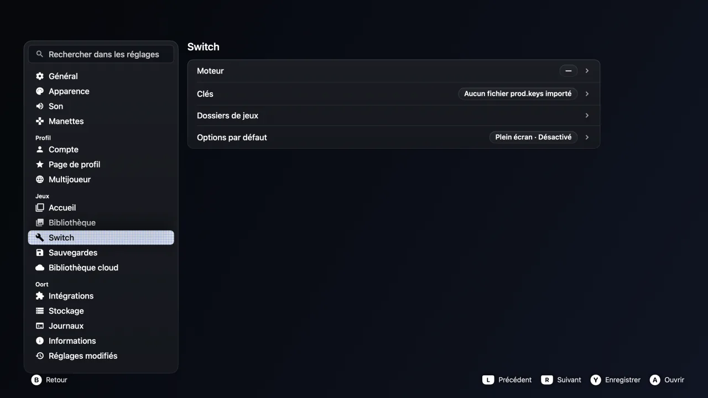
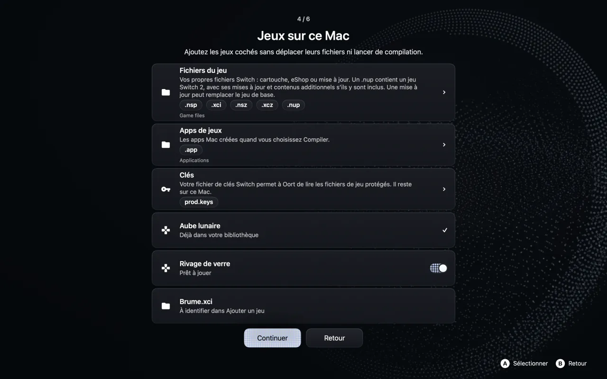
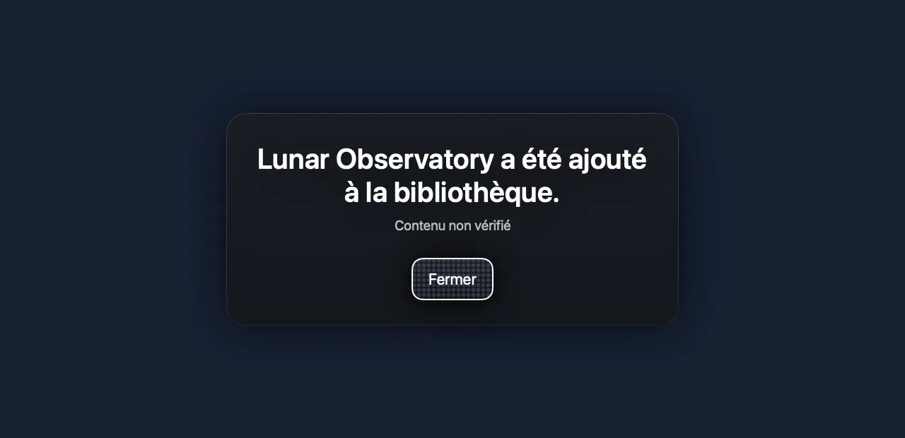

## Dis où sont tes apps
<!-- step folder code bf0c3410:Sources/NXLibrary/Views/Settings/SettingsLibrarySection.swift bf0c3410:PLAYER-GUIDE.md -->
**Réglages › Switch › Dossiers de jeux**, ligne **Apps de jeux**. Changer de dossier ne déplace aucune app.

## Analyse
<!-- step scan code bf0c3410:Sources/NXLibraryCore/Settings/SettingsCatalog.swift bf0c3410:PLAYER-GUIDE.md -->
**Analyser les apps de jeux › Analyser**. Un jeu déjà compilé se lance sans Xcode ni fichiers d’origine.

## Ou donne une copie
<!-- step adopt checked bf0c3410:Tests/CatalogAppChecks/run_cloud_screens.py bf0c3410:Sources/NXLibrary/Views/AddGame/AddGameRows.swift -->
**Ajouter un jeu › Ajouter une app déjà portée** copie l’app et vérifie sa signature. N’ajoute que ce qui vient d’une source sûre.

