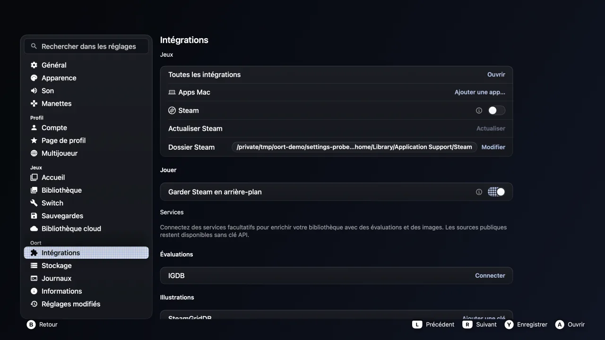
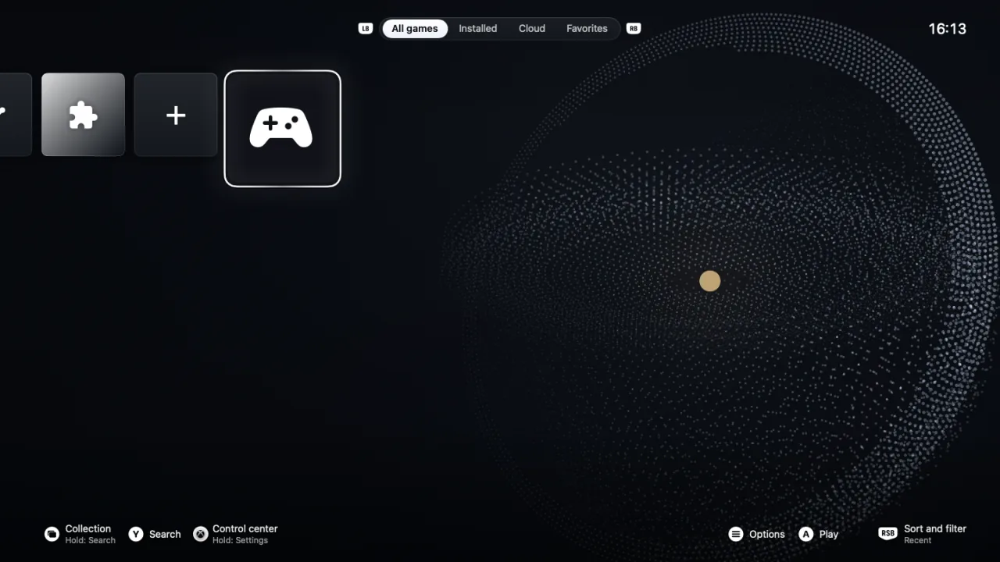

## Active Steam
<!-- step on checked bf0c3410:Sources/NXLibrary/Views/Settings/SettingsSourcesSection.swift bf0c3410:Tests/CatalogAppChecks/run_settings_confirmations.py -->
**Réglages › Intégrations › Steam**. Oort lit la liste des jeux installés et n’écrit rien chez Steam.

## Actualise
<!-- step refresh code bf0c3410:Sources/NXLibrary/Views/Settings/SettingsSourcesSection.swift bf0c3410:docs/how-it-works/steam.md -->
**Actualiser Steam** relit la liste. Seuls les jeux pour Mac installés apparaissent.

## Joue
<!-- step play checked bf0c3410:Tests/CatalogAppChecks/run_profiles.py bf0c3410:docs/how-it-works/steam.md -->
**Jouer** passe par Steam, qui ouvre le jeu. Vérifié avec un faux Steam.

