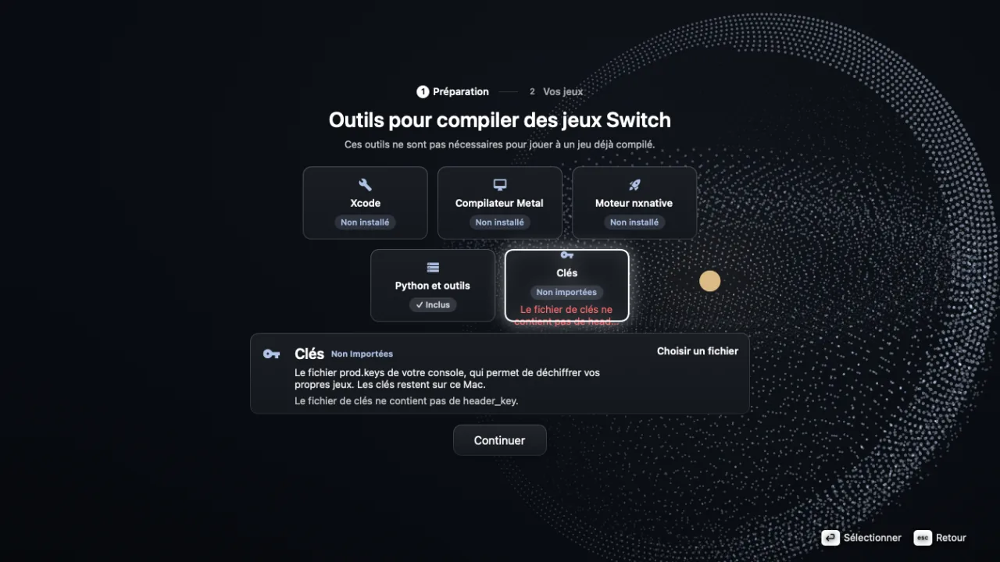
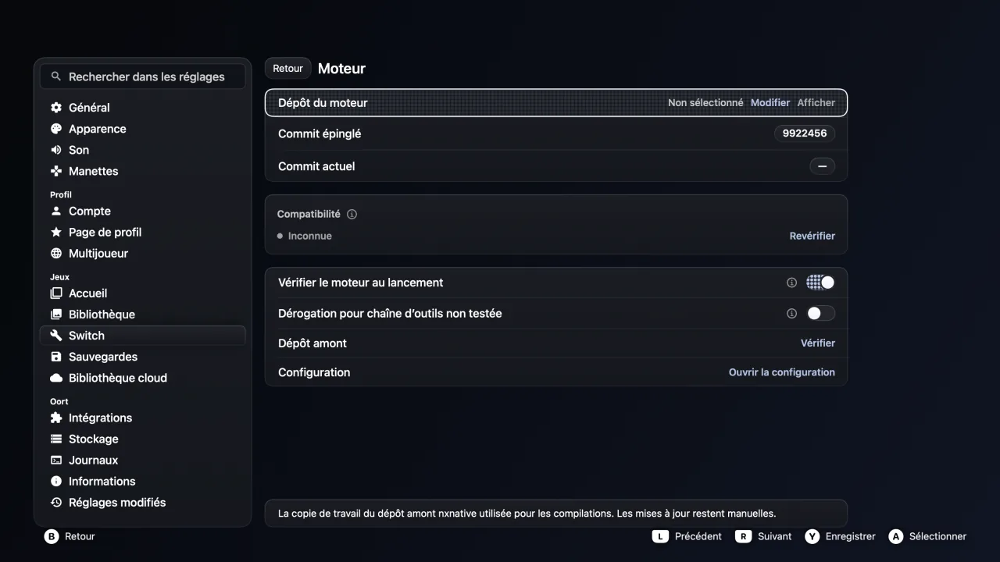
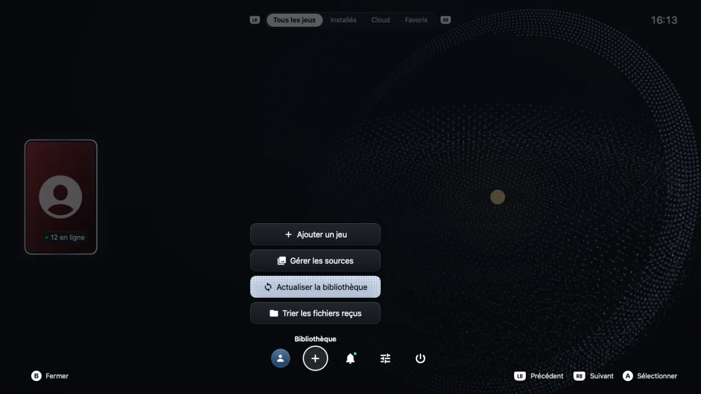
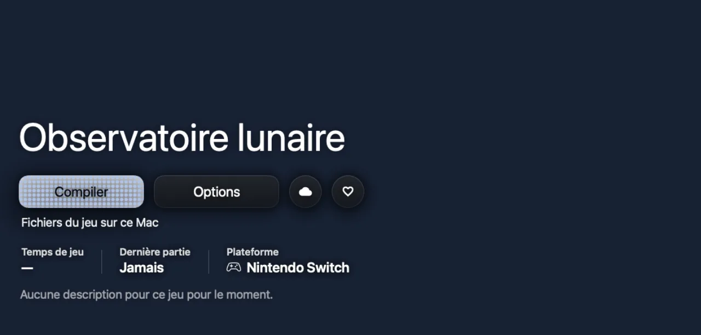

## Ce qu’il te faut
<!-- step needs code bf0c3410:PLAYER-GUIDE.md bf0c3410:README.fr.md -->
Tes propres fichiers de jeu, ton `prod.keys`, et le droit de t’en servir. Oort ne fournit ni jeu, ni clé, ni firmware. Compiler demande aussi Xcode 27.2 ou plus récent, le compilateur Metal attendu et macOS 26.6.

## Prépare les outils
<!-- step tools code bf0c3410:Sources/NXLibrary/Views/Setup/SetupCheckView.swift bf0c3410:PLAYER-GUIDE.md -->
**Réglages › Switch › Moteur › Ouvrir la configuration** montre ce qui manque. Chaque installation demande ton accord et montre sa destination.

## Choisis les fichiers
<!-- step choose code bf0c3410:Sources/NXLibrary/Views/AddGame/AddGameView.swift bf0c3410:Sources/NXLibrary/Views/AddGame/AddGameRows.swift -->
**Ajouter un jeu**, ou ⌘N, puis tes fichiers NSP, XCI, NSZ, XCZ ou NUP. Ils restent à leur place.

## Vérifie
<!-- step review code bf0c3410:Sources/NXLibrary/Views/AddGame/AddGameView.swift bf0c3410:PLAYER-GUIDE.md -->
Regarde le jeu, la mise à jour, les DLC, la destination et la place. **Ajouter uniquement à la bibliothèque** garde le jeu pour plus tard.

<!-- missing add-review: L’étape « Vérification » avec un jeu inventé. -->

## Compile
<!-- step build code bf0c3410:Sources/NXLibrary/Views/AddGame/AddGameStepThreeView.swift bf0c3410:PLAYER-GUIDE.md -->
**Ajouter et compiler** lance le moteur ; tu peux fermer l’écran, il continue. Le temps dépend du jeu et du Mac. Aucun vrai jeu n’a été compilé avec cette version.

