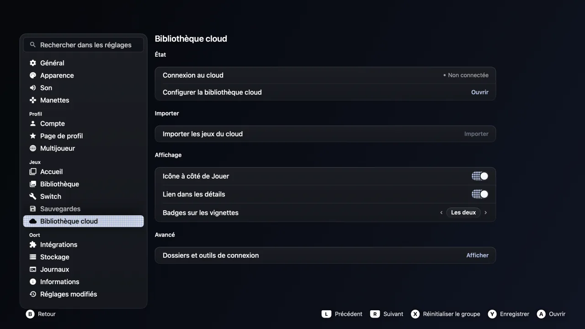
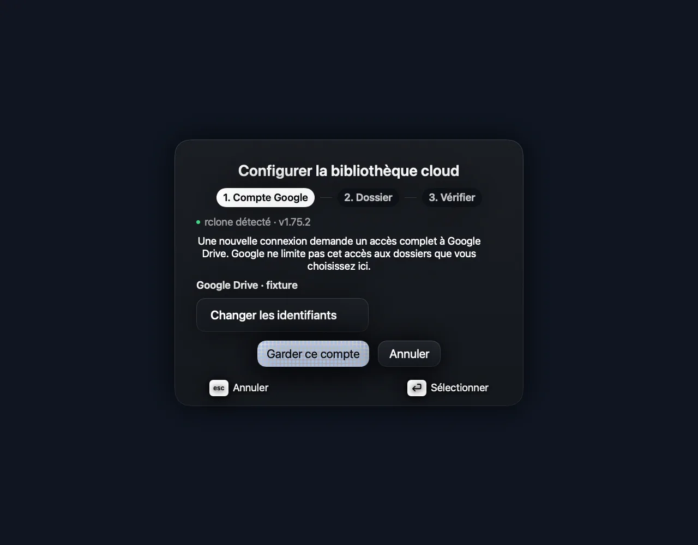
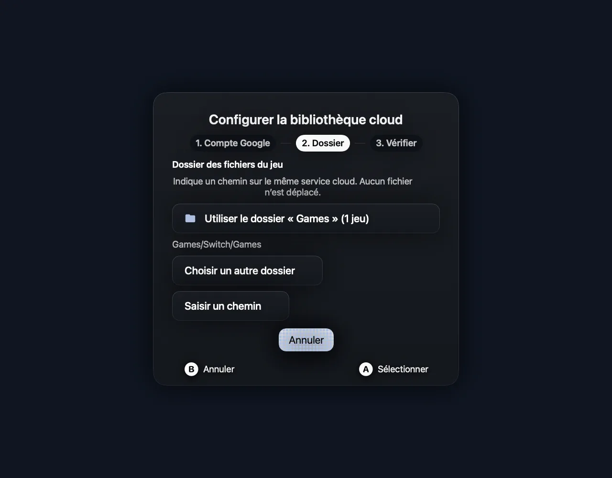
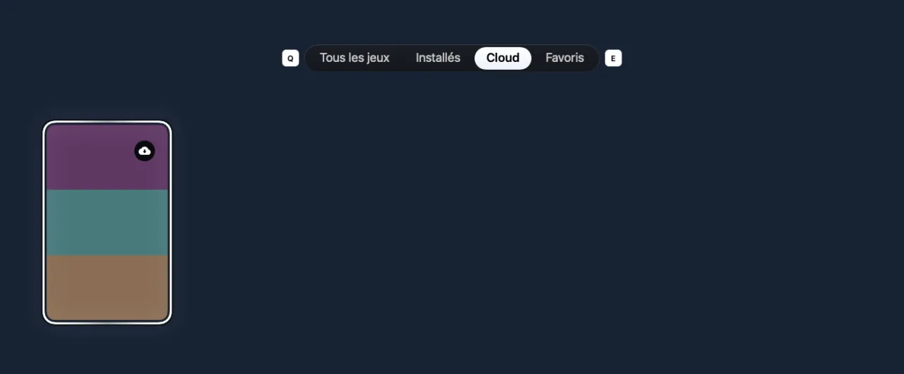

## À quoi ça sert
<!-- step what code bf0c3410:PLAYER-GUIDE.md bf0c3410:Sources/NXLibraryCore/Library/RcloneConfiguration.swift -->
Garder en ligne tes jeux compilés et les retrouver sur un autre Mac. Seul Google Drive est pris en charge, et tes sauvegardes n’y sont pas. **Garde une copie de ce qui compte.**

## L’outil : rclone
<!-- step tool code bf0c3410:Sources/NXLibraryCore/Library/RcloneDownload.swift bf0c3410:Sources/NXLibrary/Views/Settings/SettingsCloudLibrarySection.swift -->
Oort utilise le rclone déjà sur ton Mac, ou demande avant de prendre celui de rclone.org. **Avancé** permet de choisir le tien.

## Connecte Google
<!-- step account checked bf0c3410:Sources/NXLibrary/Views/Settings/CloudSetupAssistant.swift bf0c3410:Tests/CatalogAppChecks/run_cloud_screens.py -->
Garde une connexion existante, ou **Se connecter**. Google accorde à rclone l’accès à tout ton Drive, pas à un seul dossier.

## Choisis le dossier
<!-- step folder checked bf0c3410:Sources/NXLibrary/Views/Settings/CloudSetupAssistant.swift bf0c3410:Tests/CatalogAppChecks/run_cloud_screens.py -->
Oort cherche une bibliothèque dans `Games`, sinon tu donnes un chemin. Rien n’est déplacé par ce choix.

## Télécharge un jeu
<!-- step use checked bf0c3410:Tests/CatalogAppChecks/run_store_next_step.py bf0c3410:Tests/CatalogAppChecks/run_cloud_screens.py -->
L’onglet **Cloud** montre ce qui est en ligne. **Télécharger l’app** la ramène ; **Télécharger les fichiers du jeu** demande ensuite de compiler.

## Débranche
<!-- step stop code bf0c3410:Sources/NXLibrary/Views/Settings/SettingsCloudLibrarySection.swift bf0c3410:PLAYER-GUIDE.md -->
**Déconnecter** retire la connexion de ce Mac. Les fichiers restent dans ton Drive. La connexion rclone peut servir à d’autres outils.

