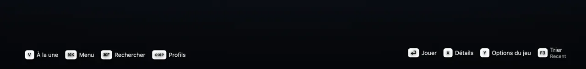
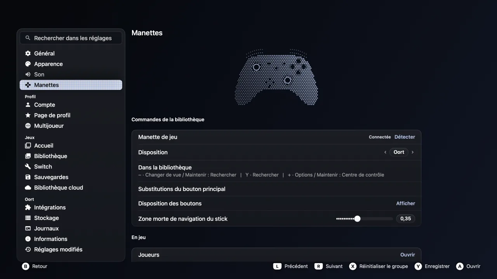

## Les touches utiles
<!-- step keys checked bf0c3410:Tests/CatalogAppChecks/run_keymap_screens.py bf0c3410:docs/how-it-works/keymap.md -->
Les rappels sont en bas de l’écran.

| Action | Xbox | Switch | PlayStation | Clavier |
|---|---|---|---|---|
| Jouer, choisir | A | A | Croix | Entrée |
| Retour | B | B | Rond | Échap |
| Détails | X | X | Carré | X |
| Rechercher | Y | Y | Triangle | ⌘F |
| Options du jeu | Menu | + | Options | Y |
| Grille ou à la une | View | − | Pavé tactile | V |
| Onglet précédent, suivant | LB / RB | L / R | L1 / R1 | Q / E |
| Trier | Stick droit | Stick droit | R3 | F3 |
| Centre de contrôle | Maintenir Menu | Maintenir + | Maintenir Options | ⌘K |
| Réglages | Maintenir Guide | Maintenir Home | Maintenir PS | ⌘, |

## Deux dispositions
<!-- step layout code bf0c3410:docs/how-it-works/keymap.md bf0c3410:Sources/NXLibraryCore/Settings/SettingsCatalog.swift -->
Ce tableau est la disposition **Oort**. Un profil d’avant garde **Arcane**, où les réglages sont sur Menu maintenu : **Réglages › Manettes › Disposition**.

## Le bouton Home
<!-- step home code bf0c3410:docs/how-it-works/keymap.md bf0c3410:Sources/NXLibrary/Views/Settings/SettingsControllersSection.swift -->
Si macOS le garde pour lui, Oort le dit une fois. **Substitutions du bouton principal** ouvre le réglage de macOS.

## Essaie ta manette
<!-- step see checked bf0c3410:Tests/CatalogAppChecks/run_controller_identity.py bf0c3410:Sources/NXLibrary/Views/OortUI/OortControllerView.swift -->
Dans **Réglages › Manettes**, elle se dessine en points et allume ce que tu presses. Pas essayé avec une vraie manette dans cette version.

