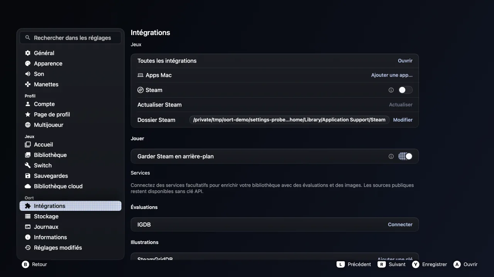
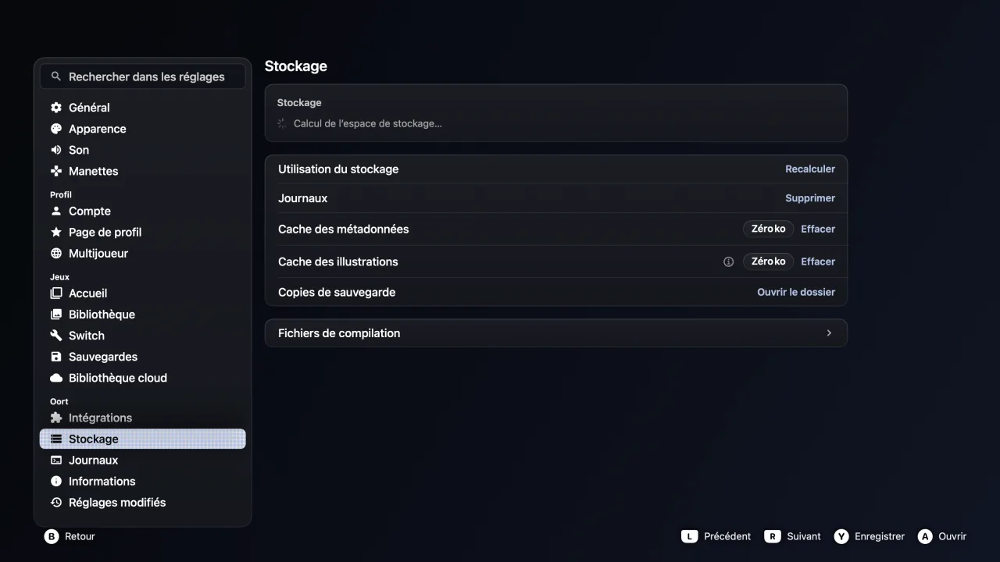
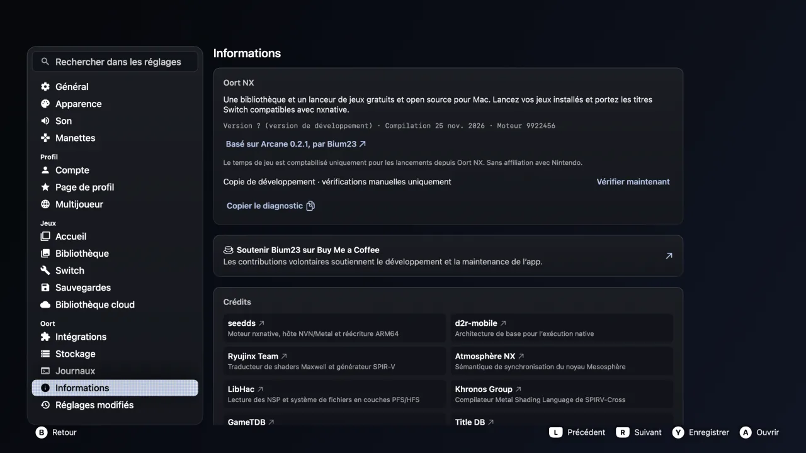
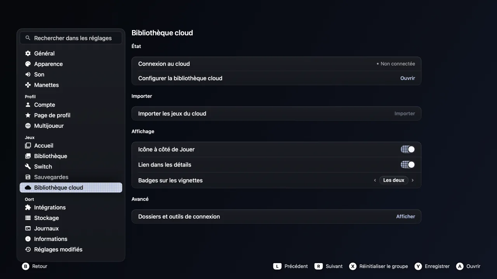

## Lit
<!-- step reads code bf0c3410:docs/how-it-works/steam.md bf0c3410:docs/how-it-works/architecture.md -->
Les dossiers que tu choisis. Si tu l’actives, les listes de jeux de Steam. Si tu compiles, tes fichiers et tes clés, sur ce Mac.

## Écrit
<!-- step writes code bf0c3410:docs/how-it-works/architecture.md bf0c3410:Sources/NXLibraryCore/App/AppDataProfile.swift -->
`~/Library/Application Support/Oort NX`, les apps qu’il compile, et les réglages et mods des jeux compilés. Rien chez Steam. La copie de tes clés est lisible par toi seul.

## Envoie, de lui-même
<!-- step alone code bf0c3410:Sources/NXLibraryCore/Resources/Localizable.xcstrings bf0c3410:docs/how-it-works/architecture.md -->
Il demande à GitHub s’il existe une version plus récente. Il cherche images, notes et descriptions avec le nom ou le numéro de tes jeux : Nlib, GameTDB, Steam, Wikidata, Wikipédia et d’autres sources publiques.

## Envoie, si tu le demandes
<!-- step asked code bf0c3410:Sources/NXLibraryCore/Resources/Localizable.xcstrings bf0c3410:PLAYER-GUIDE.md -->
Google Drive, Nextendo, mods GameBanana, SteamGridDB, IGDB : seulement une fois activés, avec ton propre compte s’il en faut un. Compiler n’envoie ni fichier de jeu ni clé.

