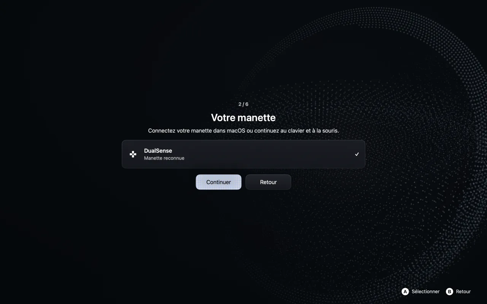
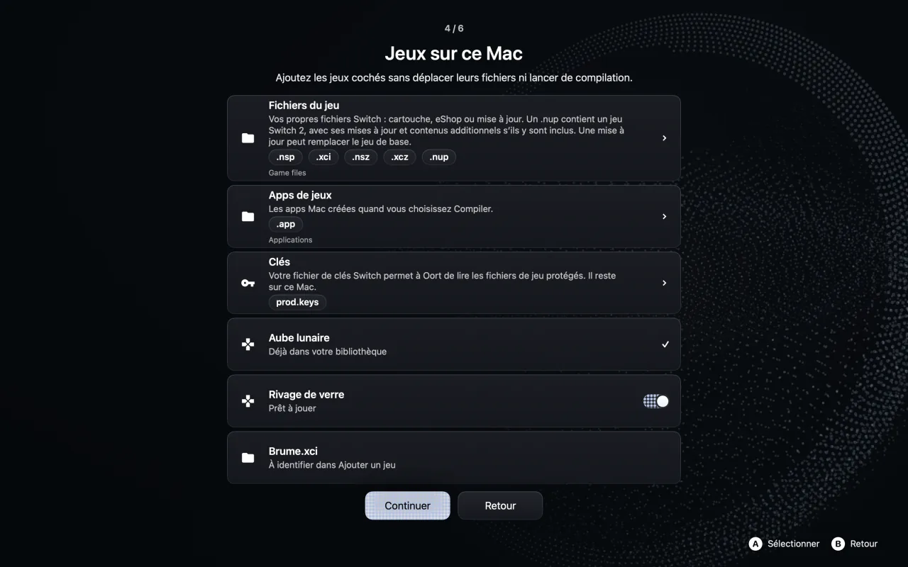
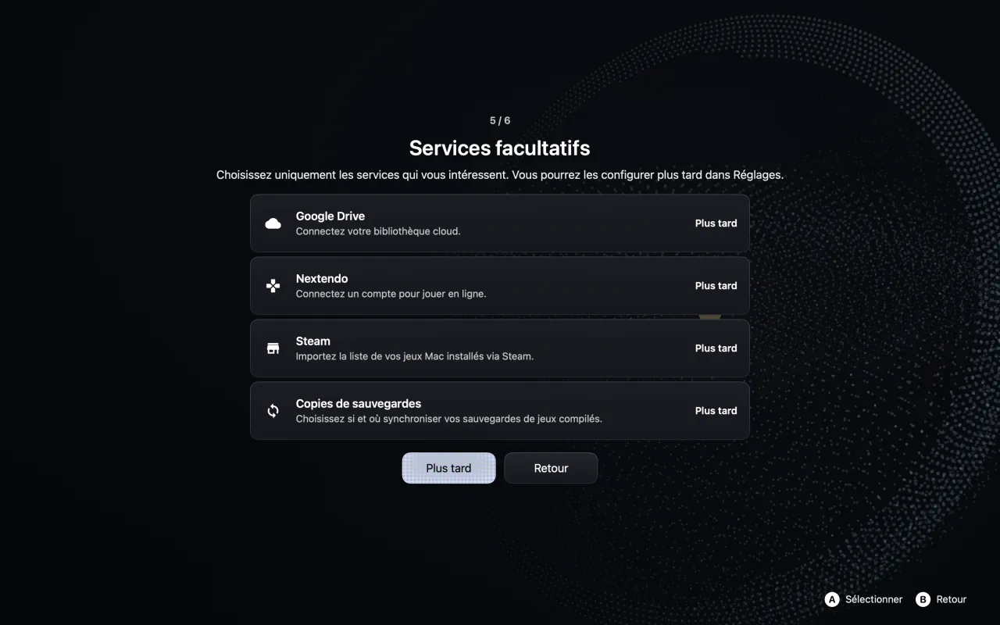
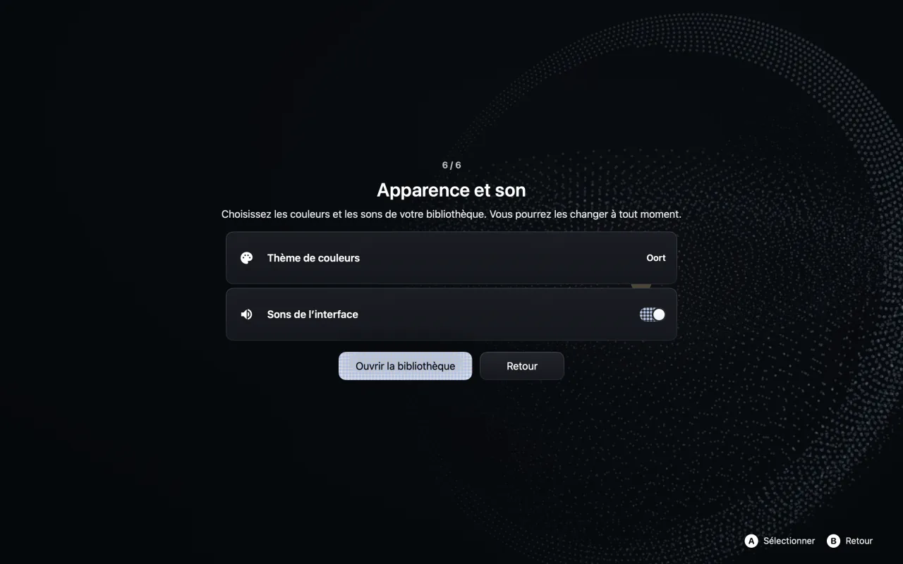

## Tu viens de la 0.3.0 ?
<!-- step old code bf0c3410:Sources/NXLibraryCore/App/AppDataProfile.swift bf0c3410:CHANGELOG.md https://github.com/sofianbll/oort-nx/releases/tag/v0.5.0-beta.3 -->
Ta bibliothèque est copiée et chaque fichier vérifié ; l’ancienne reste intacte. Reconnecte tes services une fois, et n’ouvre pas les deux versions ensemble.

<!-- missing library-copy: L’écran de copie de la bibliothèque 0.3.0. -->

## Ta manette
<!-- step controller checked bf0c3410:Sources/NXLibrary/Views/Setup/OnboardingView.swift bf0c3410:Tests/CatalogAppChecks/run_onboarding.py -->
L’accueil dit si elle est reconnue. Sinon, continue au clavier ou à la souris.

## Les jeux déjà là
<!-- step games checked bf0c3410:Sources/NXLibrary/Views/Setup/OnboardingView.swift bf0c3410:Tests/CatalogAppChecks/run_onboarding.py -->
Oort liste les apps de jeux trouvées et les fichiers du dossier que tu choisis. Ajouter ne déplace rien et ne compile rien.

## Les services, plus tard
<!-- step services checked bf0c3410:Sources/NXLibrary/Views/Setup/OnboardingView.swift bf0c3410:Tests/CatalogAppChecks/run_onboarding.py -->
Google Drive, Nextendo, Steam et copies de sauvegardes sont facultatifs. **Plus tard** les laisse coupés.

## Refaire l’accueil
<!-- step again code bf0c3410:Sources/NXLibraryCore/Settings/SettingsCatalog.swift bf0c3410:PLAYER-GUIDE.md -->
**Réglages › Général › Assistant de bienvenue**. Rien n’est remis à zéro.

