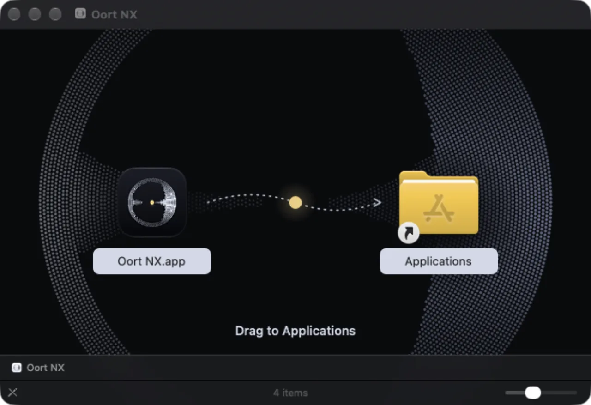
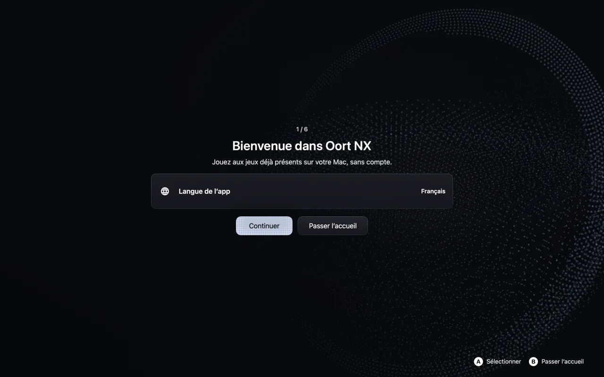

## Télécharge
<!-- step download code bf0c3410:README.fr.md bf0c3410:Package.swift https://github.com/sofianbll/oort-nx/releases/tag/v0.5.0-beta.3 -->
Prends `Oort-NX-0.5.0-beta.3.dmg` sur la [page de la version](https://github.com/sofianbll/oort-nx/releases/tag/v0.5.0-beta.3). Il faut un Mac à puce Apple et macOS 26 ou plus récent.

<!-- missing release-page: La page de la version, DMG visible. -->

## Glisse dans Applications
<!-- step drag checked bf0c3410:scripts/build_dmg.sh bf0c3410:scripts/style_dmg.py -->
Ouvre le DMG et dépose Oort NX sur Applications.

## Passe l’avertissement
<!-- step warning elsewhere https://support.apple.com/102445 https://github.com/sofianbll/oort-nx/releases/tag/v0.5.0-beta.3 -->
L’app n’est pas notariée par Apple : la première ouverture est refusée. Va dans **Réglages Système › Confidentialité et sécurité**, puis **Ouvrir quand même** ([Apple l’explique](https://support.apple.com/102445)). Ne coupe pas les protections de macOS.

<!-- missing gatekeeper: Le refus de macOS, puis Ouvrir quand même. -->

## Ouvre Oort NX
<!-- step open checked bf0c3410:Sources/NXLibrary/Views/Setup/OnboardingView.swift bf0c3410:Tests/CatalogAppChecks/run_onboarding.py -->
L’accueil commence. Tu peux le passer.

